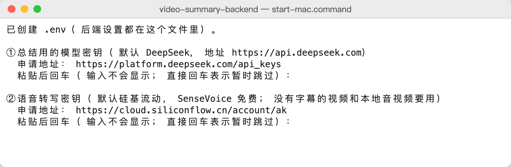
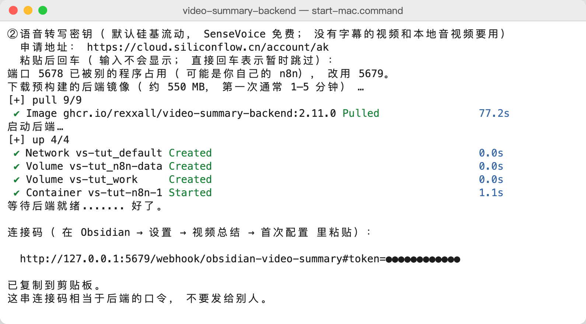
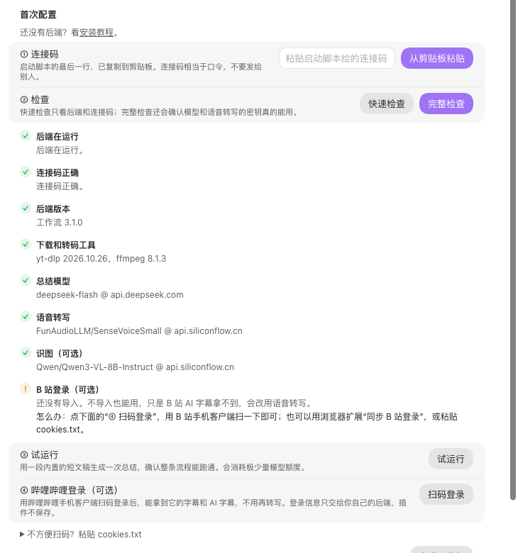
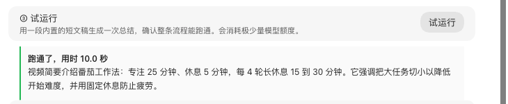
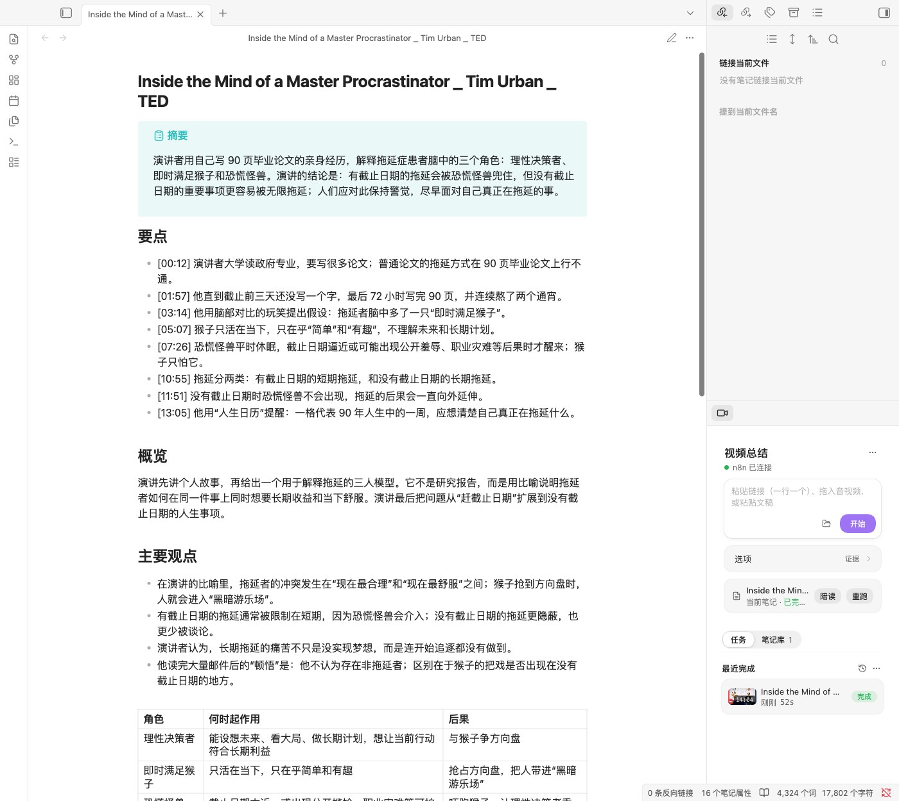
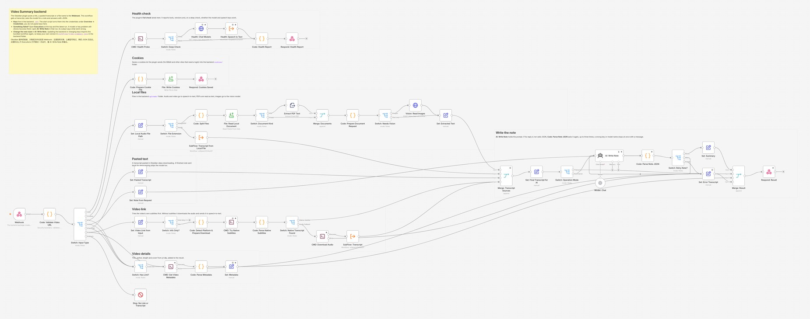
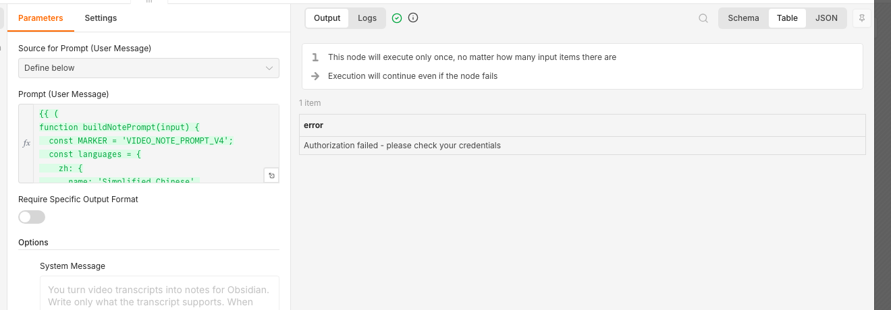

# 安装教程

[English](docs/INSTALL.en.md) · [日本語](docs/INSTALL.ja.md)

视频总结由两部分组成：Obsidian 插件，和在你自己电脑上运行的后端。后端跑在 Docker 里，负责取字幕或音频、转文字、调用模型写总结，用一个启动脚本就能装好。

**整个过程约 10 分钟。** 后端是现成的镜像，第一次下载约 550 MB，通常 1–5 分钟。

## 四步装好

### 1. 装插件和 Docker

- **插件：** Obsidian 里打开 **设置 → 第三方插件 → 浏览**，搜 **Video Summary**，安装并启用。商店里暂时搜不到时，从 [最新 Release](https://github.com/Rexxall/obsidian-video-summary/releases/latest) 下载 `video-summary-<版本>.zip`，把里面三个文件放进 `<你的库>/.obsidian/plugins/video-summary/`。
- **Docker：** 装 [Docker Desktop](https://www.docker.com/products/docker-desktop/)（Windows、macOS）或 [OrbStack](https://orbstack.dev)（macOS），打开它，等它显示正在运行。
- **两把密钥：** [DeepSeek](https://platform.deepseek.com/api_keys) 写总结；[硅基流动](https://cloud.siliconflow.cn/account/ak) 给没有字幕的视频转文字。费用见 [准备什么、花多少钱](#准备什么花多少钱)。

### 2. 下载后端，双击启动

从 [最新 Release](https://github.com/Rexxall/obsidian-video-summary/releases/latest) 下载 `video-summary-backend-<版本>.zip`，解压到一个不会被删掉的位置（**不要放进 Obsidian 库里**），然后：

- **macOS：** 右键点 `start-mac.command` →“打开”。
- **Windows：** 双击 `start-windows.cmd`；出现“Windows 已保护你的电脑”时点“更多信息 → 仍要运行”。

第一次会问两把密钥。粘贴后按回车，屏幕上不显示内容；暂时没有的直接回车跳过。

接着脚本下载后端镜像并启动。看到“好了”和一行**连接码**就成功了，连接码已经复制到剪贴板。

连接码相当于后端的口令，不要发给别人。忘了的话，在后端文件夹运行 `./vs-backend.sh code`（Windows：`.\vs-backend.ps1 code`）再显示一次。

### 3. 在 Obsidian 里粘贴连接码、检查、试运行

打开 **设置 → 视频总结**，最上面是**首次配置**：

1. **① 连接码：** 点“从剪贴板粘贴”。
2. **② 检查：** 点“完整检查”，后端、连接码、模型和语音转写逐项打勾。哪一项不对，会写出怎么改。
3. **③ 试运行：** 用一段内置短文稿生成一次总结。

**④ 哔哩哔哩登录**是可选的：用 B 站手机客户端扫码后，B 站视频会直接用字幕（包括 AI 字幕），不用转写。

### 4. 总结第一个视频

在右侧栏的输入框里粘贴视频链接，点“开始”。几十秒后笔记就写好了：开头是摘要和要点，后面是分节整理和带时间的文稿。

也可以在笔记属性里写 `link: 链接`，再运行命令“快速总结当前笔记”。不同输入怎么处理：

| 输入                        | 后端怎么做                                                                                   |
| --------------------------- | -------------------------------------------------------------------------------------------- |
| 有字幕的 B 站、YouTube 视频 | 直接用字幕，最快                                                                             |
| 没有字幕的视频              | 下载音频，用语音转写，长音频自动按 10 分钟切段                                               |
| 本地音视频                  | 先把文件放进后端文件夹的 `uploads` 里，再在笔记里写 `local_file: '文件名.mp4'`（只写文件名） |
| 本地图片、PDF               | 同上放进 `uploads`；PDF 直接提取文字，图片用识图模型读                                       |
| 已经有文稿                  | 粘贴到侧栏的“粘贴文稿”，不经过下载和转写                                                     |

## 准备什么、花多少钱

| 要什么                                               | 做什么用                                 | 去哪里拿                                                                                            |
| ---------------------------------------------------- | ---------------------------------------- | --------------------------------------------------------------------------------------------------- |
| Obsidian 桌面版                                      | 写笔记                                   | [obsidian.md](https://obsidian.md)                                                                  |
| Docker Desktop（Windows、macOS）或 OrbStack（macOS） | 运行后端                                 | [Docker Desktop](https://www.docker.com/products/docker-desktop/)、[OrbStack](https://orbstack.dev) |
| DeepSeek 密钥                                        | 写总结                                   | [DeepSeek 开放平台](https://platform.deepseek.com/api_keys)，充值几元就够用很久                     |
| 硅基流动密钥                                         | 没有字幕的视频、本地音视频转文字；读图片 | [硅基流动](https://cloud.siliconflow.cn/account/ak)，语音转写模型免费                               |
| 哔哩哔哩账号（可选）                                 | 拿 B 站字幕和 AI 字幕                    | 手机客户端扫码即可                                                                                  |

**费用：** 以下价格按 2026-10-29 的官方价格页核对，以对方页面为准。

- **DeepSeek：** 默认模型 `deepseek-flash` 每百万词元输入 1–2 元、输出 4–8 元，工作日白天是高峰价，其余时间半价（[价格页](https://api-docs.deepseek.com/zh-cn/quick_start/pricing)）。总结一个半小时以内的视频通常只要几分钱。
- **硅基流动：** 语音转写模型 `FunAudioLLM/SenseVoiceSmall` 免费（[价格页](https://siliconflow.cn/pricing)），但账户里要有余额：实测余额为 0 时，连免费模型也会被拒绝（402），充值一两元即可。读图片默认用 `Qwen/Qwen3-VL-8B-Instruct`，按量计费，读一张图通常不到一分钱。
- **实测：** 2026-10-29 验收时跑了 8 次总结（包括一段 47 分钟的视频），DeepSeek 一共花了约 0.4 元（非高峰时段）。

只想用一家？可以全部用硅基流动：把总结模型也换成硅基流动上的 DeepSeek，见 [换模型](#换模型)。

## 平台说明

- **B 站：** 优先使用。顺序是“UP 主上传的字幕 → B 站 AI 字幕 → 语音转写”。AI 字幕需要先完成第 4 步的扫码登录。
- **YouTube：** 在中国大陆需要代理。在后端的 `.env` 里填 `VS_HTTP_PROXY`（例如 `http://host.docker.internal:7890`），再运行一次启动脚本。
- **TikTok：** 视频自带字幕时直接用字幕（中文优先，其次英文），没有字幕才下载音频转写。
- **抖音、小红书、TikTok：** 尽力而为。平台经常改接口，失败时多半要换新版后端（新版带新的下载器，见下面的“升级到新版本”）或导入登录 cookie；实在不行，就把文案复制出来走“粘贴文稿”。

## 日常使用

在后端文件夹里运行（Windows 把 `./vs-backend.sh` 换成 `.\vs-backend.ps1`）：

| 命令                     | 作用                                             |
| ------------------------ | ------------------------------------------------ |
| `./vs-backend.sh`        | 启动；改过 `.env` 后也用它让设置生效             |
| `./vs-backend.sh check`  | 检查模型、语音转写和 B 站登录是否可用            |
| `./vs-backend.sh code`   | 再显示一次连接码                                 |
| `./vs-backend.sh keys`   | 重新输入密钥                                     |
| `./vs-backend.sh logs`   | 看后端日志                                       |
| `./vs-backend.sh stop`   | 停止后端（数据保留）                             |
| `./vs-backend.sh update` | 重新下载这个版本的后端镜像（下载不了时重新构建） |

升级到新版本：下载新的后端压缩包，解压覆盖旧文件夹（`.env`、`uploads`、`cookies` 会保留），再运行 `./vs-backend.sh update`。

### 换模型

所有总结步骤共用一个模型，任何兼容 OpenAI 接口的服务都可以。改后端文件夹里的 `.env`，再运行一次启动脚本：

| 服务             | `VS_CHAT_BASE_URL`                                        | `VS_CHAT_MODEL`                   |
| ---------------- | --------------------------------------------------------- | --------------------------------- |
| DeepSeek（默认） | `https://api.deepseek.com`                                | `deepseek-flash`                  |
| 硅基流动         | `https://api.siliconflow.cn/v1`                           | `deepseek-ai/DeepSeek-V4.1-Flash` |
| 通义千问         | `https://dashscope.aliyuncs.com/compatible-mode/v1`       | `qwen-plus`                       |
| Kimi             | `https://api.moonshot.cn/v1`                              | 以 Kimi 控制台的模型列表为准      |
| Gemini（可选）   | `https://generativelanguage.googleapis.com/v1beta/openai` | `gemini-flash-latest`             |

`VS_CHAT_API_KEY` 填对应服务的密钥。语音转写（`VS_SPEECH_*`）和识图（`VS_VISION_*`）同理，可以换成任何兼容 `/audio/transcriptions` 和 `/chat/completions` 的服务。

## 排错

先在 Obsidian 的“首次配置”里点“完整检查”，它会给出具体做法。常见情况：

| 现象                                                                                    | 原因                                            | 怎么办                                                                                        |
| --------------------------------------------------------------------------------------- | ----------------------------------------------- | --------------------------------------------------------------------------------------------- |
| 启动脚本说“没有找到 Docker”或“Docker 没有在运行”                                        | Docker 没装或没打开                             | 打开 Docker Desktop／OrbStack，等它显示运行中，再运行启动脚本                                 |
| macOS 提示“无法打开，因为它来自身份不明的开发者”                                        | 系统对下载文件的保护                            | 右键 `start-mac.command` →“打开”                                                              |
| 下载后端镜像很慢或失败                                                                  | 连不上 GitHub 的镜像仓库                        | 脚本会自动改为本机构建（约 10 分钟）；在国内可在 `.env` 设 `VS_MIRROR=cn`，直接用国内镜像构建 |
| “端口 5678 已被占用，改用 5679”                                                         | 电脑上已有别的 n8n                              | 不用管，连接码里已经是新端口                                                                  |
| 检查显示“连不上后端”                                                                    | 后端没在运行                                    | 打开 Docker，再运行启动脚本                                                                   |
| 检查显示“后端还没准备好”                                                                | 刚启动，n8n 还在加载                            | 等一分钟再检查                                                                                |
| 检查显示“连接码不对”                                                                    | 重新生成过 `.env`，或复制不完整                 | 运行 `./vs-backend.sh code`，重新粘贴                                                         |
| 总结模型“服务商不认这个密钥”                                                            | 密钥填错或已删除                                | 运行 `./vs-backend.sh keys` 重新输入                                                          |
| 总结模型或语音转写“余额不足”“Payment required”                                          | 账户没钱了；硅基流动余额为 0 时免费模型也不能用 | 到服务商控制台充值一两元                                                                      |
| “服务商的模型列表里没有这个名字”                                                        | `VS_CHAT_MODEL` 写错                            | 按上面的换模型表核对                                                                          |
| “后端连不上 api.xxx.com”                                                                | 网络或代理问题                                  | 检查网络；需要代理时填 `VS_HTTP_PROXY`                                                        |
| B 站视频下载报 412                                                                      | B 站拦截了旧版下载器                            | 换新版后端；仍不行就在首次配置里扫码登录                                                      |
| B 站视频没用字幕、走了语音转写                                                          | 没登录，或视频本身没有字幕                      | 扫码登录；没有字幕的视频只能转写                                                              |
| 本地文件报“must be a supported file name placed directly in the backend uploads folder” | 文件不在 `uploads` 里，或写了路径               | 把文件放进后端的 `uploads`，笔记里只写文件名                                                  |
| 笔记里出现“Error: 模型调用失败”                                                         | 模型密钥、余额或模型名有问题                    | 按错误后面的提示改 `.env`                                                                     |

### 在 n8n 里看是哪一步出的错

浏览器打开连接码里的地址（默认 <http://127.0.0.1:5678>）。第一次打开要建一个 n8n 账号，只存在你这台电脑的后端里。进去后打开 **Video Summary** 工作流：左上角的黄色便签说明整体流程，灰色便签标出每种请求走哪条线。

点顶部的 **Executions**，打开最近一次运行。模型或密钥出错时这次运行仍显示 Success，因为错误要交回插件显示；打开 **AI: Write Note** 节点，右边的输出写着原因。

还解决不了：运行 `./vs-backend.sh logs`，把最后几十行（先删掉看起来像密钥的内容）附在 [Issue](https://github.com/Rexxall/obsidian-video-summary/issues) 里。

## 安全说明

- 后端只在本机 `127.0.0.1` 上开放，局域网和外网访问不到。
- 密钥只存在后端文件夹的 `.env` 和后端自己的数据卷里，插件不保存模型密钥。
- B 站登录信息只交给你自己的后端，用于下载字幕，插件不保存。
- 不要把后端端口改成对外开放；确实需要远程访问时，见 [backend/SECURITY.md](backend/SECURITY.md)。

## 进阶

- **改用自己的 n8n：** 安装包里的工作流在 `workflows/` 文件夹，凭据由 `init/configure.mjs` 生成，可以参考。手动导入时要自己装 yt-dlp 和 ffmpeg，并设置 `NODES_EXCLUDE` 放行 Execute Command 节点。
- **换语音转写方案：** 见 [语音转写子流程约定](docs/ASR_SUBWORKFLOW_CONTRACT.md)。
- **从源码构建插件：** `npm install && npm run build`。
