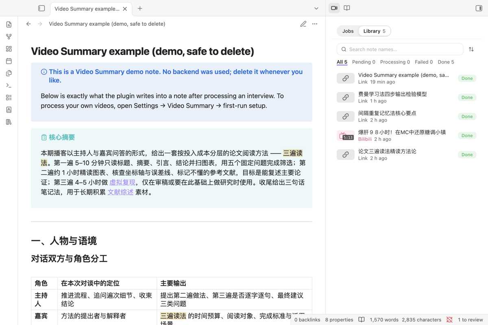

<picture><source media="(prefers-color-scheme: dark)" srcset="assets/readme/icon-dark.svg"></picture>

# Video Summary

**動画のリンク、手元の録音・録画、または文字起こしから、要約・タイムスタンプ付き文字起こし・要点をまとめた Obsidian ノートを作ります。**

[English](README.md) · [中文](README.zh-CN.md) · 日本語

Obsidian が中国語以外の設定のとき、プラグインの画面は英語で表示されます。

## はじめかた

1. Video Summary を有効にし、コマンドパレットからサイドパネルを開きます。
2. **See an example note**（例のノートを見る）を押すと、完成したノートが 1 本作られます。何も設定せずに結果を確認できます。
3. 自分の動画を処理するには、Docker Desktop か OrbStack を入れて **Settings → Video Summary → Backend** を開きます。macOS では、要約モデルを選び、要約用と音声認識用のキーを追加して（Obsidian のシークレットストレージに保存されます）、**Install and start** を押します。プラグインがバックエンドのフォルダ（`~/video-summary-backend`）を書き出してターミナルを開きます。ターミナルは実行するコマンドを表示し、Return を押すまで約 550 MB のイメージをダウンロードしません。プラグインが自分でダウンロードや更新をすることはありません。
4. Obsidian に戻ると、設定ページがモデルとキーをバックエンドに渡し、チェックと試運転まで自動で進めます。Windows ではこの手順は未検証です。起動スクリプトと接続コードを使ってください（[インストールガイド](docs/INSTALL.ja.md)）。
5. サイドパネルにリンクを貼り、**Start** を押します。

## 必要なものと費用

- プラグイン：無料、アカウント不要、デスクトップ版のみ。
- バックエンド：自分のパソコンの Docker（Docker Desktop または OrbStack、個人利用は無料）で動きます。
- 文字起こし：SiliconFlow の `SenseVoiceSmall`。字幕のない動画と手元のファイルだけに使います。モデルは無料ですが、残高が 0 だと使えません。
- 要約モデル：既定は DeepSeek `deepseek-flash`。OpenAI 互換のモデルなら何でも使えます。料金は各社の従量課金です。

## データの行き先

リンクや文字起こしは自分のパソコンのバックエンド（`127.0.0.1`）にだけ送られます。設定で選んだキーは Obsidian のシークレットストレージと、バックエンド自身の Docker ボリュームに置かれます（起動スクリプトで入れたキーはバックエンドの `.env`）。保管庫には入りません。テレメトリーや解析はなく、作者には何も送られません。デスクトップ版では、ブラウザ拡張機能が Obsidian を前面に出さずに動画を渡せるよう `127.0.0.1` のポート（既定 27183）で待ち受けます。ペアリングコード付きの要求だけを受け付け、Web ページからの要求は拒否します（**設定 → Video Summary → ブラウザ拡張機能** でオフにできます）。再処理ではプラグインが管理するブロックだけを置き換え、自分で書いた部分は残ります。詳しくは [英語版 README](README.md#privacy-and-data)。

## ライセンス

MIT
