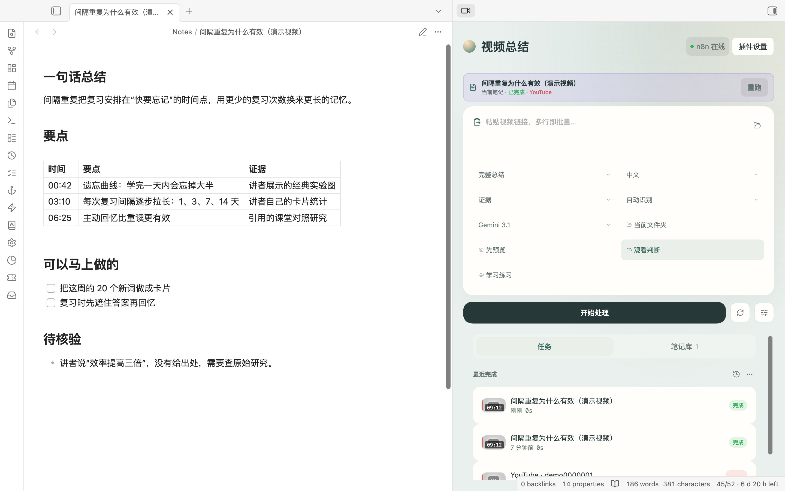

<div align="center">

# Video Summary

**Turn videos, local recordings, and rough transcripts into evidence-linked, searchable Obsidian knowledge.**

把视频链接、本地录音录像和现成文稿，整理成带时间戳出处、可检索的 Obsidian 笔记。

[What's new](#whats-new-in-280) · [Install](#install) · [Backend](#backend) · [Privacy](#privacy-and-data-boundary) · [中文说明](#中文说明) · [日本語](#日本語)

<picture>
  <source media="(prefers-color-scheme: dark)" srcset="docs/screenshots/panel-dark.jpg">
  
</picture>

</div>

Video Summary connects Obsidian to a processing endpoint you control. The repository includes a
general-purpose n8n workflow; the plugin can also talk to a compatible external Worker endpoint.
It keeps the reader-facing result in Markdown and stores structured evidence, learning state, and
reproducibility metadata as local plugin sidecars.

## What's new in 2.8.0

- **One-download backend.** The release now has `video-summary-backend-2.8.0.zip` in place of the
  bare n8n workflow. Unzip it, double-click `start-mac.command` (macOS) or `start-windows.cmd`
  (Windows), paste your keys, and it builds and starts n8n with yt-dlp and ffmpeg. It switches to
  mainland-China mirrors by itself when Docker Hub is unreachable, picks a free port when 5678 is
  taken, and prints a connection code. Nothing to import or click in n8n: credentials and both
  workflows are created on first start.
- **One model for everything.** Every AI step uses one OpenAI-compatible model, set in `.env`.
  Default DeepSeek `deepseek-flash`; SiliconFlow, Qwen, Kimi or Gemini need only a different
  address and model name. The ten per-provider model nodes and unused branches are gone (61 → 51
  nodes).
- **Speech-to-text included.** Videos without subtitles and local audio/video work out of the box
  with SiliconFlow's free SenseVoice. Long audio is cut into 10-minute parts and joined in order.
  Local images are read by an OpenAI-compatible vision model; PDFs by n8n's own text extraction.
- **Bilibili first.** Uploader subtitles, then Bilibili's AI subtitles, then speech-to-text;
  danmaku is never used as a transcript. New in the setup wizard: scan a QR code with the Bilibili
  app to give your backend the login it needs for subtitles. Browser extension 0.6.0 can sync the
  login too, and now sends the backend password with its requests.
- **First-run setup in the plugin.** Settings → 视频总结 → 首次配置: paste the connection code
  from the clipboard, run the full check (backend, code, workflow version, yt-dlp and ffmpeg,
  model key and name, speech-to-text, Bilibili login), then a trial run. Every failed step says
  what to change. Wrong or missing model keys now end a job with that message instead of four
  silent retries.
- The plugin no longer keeps a list of model labels; the model name shown with each result comes
  from the backend.
- **Fixed (affects 2.7.0):** requests from the plugin to the backend failed inside Obsidian with
  "Failed to resolve module specifier 'obsidian'"; the bundle now loads Obsidian's API with
  `require`. Also fixed: every Bilibili link stopped at "Short-link redirect limit exceeded";
  logged-in Bilibili videos ignored their AI subtitles; `local_file: '…'` written with quotes was
  never found; links failed in n8n 2.x Code nodes, which have no `URL` global.
- Downloaded audio and subtitles older than a day are removed from the backend's working volume.
- Install guide rewritten in Chinese, with shorter English and Japanese versions.

Earlier releases: [CHANGELOG.md](CHANGELOG.md).

## What it does

- Accept one URL, multiple URLs, n8n upload-root local media filenames, pasted transcripts, or
  webhook JSON in the sidebar. Commands operate on the current note or batch selection;
  `obsidian://video-summary` captures a URL or validated absolute local media path.
- Generate Markdown notes plus timestamped transcript segments, evidence-backed claims,
  provenance, attention guidance, and optional learning cards.
- Read local media and YouTube beside the transcript, seek from evidence, and keep user highlights.
  Bilibili currently supports click-to-seek but not automatic playback tracking.
- Route courses, interviews, tutorials, news, meetings, reviews, and general videos into distinct
  output structures.
- Compile supported playlists into incremental course manifests without spending model quota
  during import.
- Search transcript, OCR, screen text, visual descriptions, titles, authors, and claims through one
  local cross-modal index.
- Compare two or more persisted videos in a review-gated claim matrix.
- Review flashcards and questions with local progress and due-date scheduling.
- Keep a searchable video library with real job status, cover images, retry, cancellation where the
  backend supports it, and optional preview before write.
- Switch between endpoint profiles, reuse cached results, and reprocess from verified local
  artifacts without reacquiring the source.

## Video knowledge workflow

| Direction                 | Durable result                                                           | Requirement or boundary                                                                  |
| ------------------------- | ------------------------------------------------------------------------ | ---------------------------------------------------------------------------------------- |
| Evidence map              | Timed segments, claims, source type, confidence, and provenance          | Precise links require a timed transcript                                                 |
| Synchronized reader       | Player, active transcript, seek links, and persistent highlights         | Local media and YouTube can follow playback; Bilibili is click-to-seek                   |
| Visual understanding      | Keyframes, OCR, and visual-only observations                             | Deep visual requires a separately deployed compatible Worker, ffmpeg, and a visual model |
| Content routing           | Course, interview, tutorial, news, meeting, review, or general structure | Manual choice overrides automatic routing                                                |
| Attention assessment      | `watch`, `skim`, or `skip`, transparent scores, and bounded ranges       | Missing Vault context is reported instead of invented                                    |
| Course compiler           | Incremental playlist manifest, ordering, numbered-lesson gaps, progress  | Dependencies come only from explicit adjacent lesson numbers; import does not call AI    |
| Claim Lab                 | Editable multi-video evidence matrix                                     | Requires at least two persisted artifacts; relations need human review                   |
| Cross-modal memory        | Local searchable evidence index with filters and score explanation       | Searches persisted artifacts only                                                        |
| Learning loop             | Flashcards, questions, attempts, mastery, and review schedule            | Progress is stored locally                                                               |
| Capture, Base, and replay | Offline inbox, managed `.base`, and reproducibility manifest             | Capture-only works offline; replay uses the current backend/model                        |

The bundled n8n workflow supports transcript acquisition and `evidence` depth. It does not perform
real frame analysis. `deep-visual` is available only through a compatible external Worker and is
not bundled with this repository. See the
[backend capability matrix](docs/BACKEND_CAPABILITY_MATRIX.md) before choosing a backend.

## Sidebar

The panel has four layers:

- **Action bar** — the note you currently have open and its status, one input that accepts URLs,
  multi-line batches, local file names, pasted transcripts, or webhook JSON, plus inline chips for
  mode, language, model, webhook profile, and output folder.
- **Jobs** — everything queued, running, waiting for confirmation, or recently finished. Cards show
  the current stage when the backend reports one, elapsed time, cancel, and retry. Failures show the
  actual error text.
- **Library** — every video note in the vault, backed by an incremental index rather than a full
  scan, filtered by status chips and searchable.
- **Detail** — synchronized reader, evidence, result preview, transcript, metadata, and logs, plus
  write actions: write to the note, apply to the open note, insert at the end, or create a new note.

Turn on `写入前预览` in the chip row if you want every result to stop for confirmation before it
touches a note.

## Typical workflow

1. Create a note with a `link` property, paste a URL in the sidebar, or capture it with the Obsidian
   URI.
2. Choose `quick` or `evidence` depth. Use `deep-visual` only with a configured compatible Worker.
3. Submit the job. The plugin sends the minimum selected input and settings to your endpoint.
4. The endpoint acquires or uses the transcript and returns Markdown plus any structured evidence.
5. Review the result first if `写入前预览` is enabled.
6. The plugin updates managed Markdown/frontmatter and saves machine-readable sidecars locally.
7. Open the reader, search, Claim Lab, course, or review tools when the artifact contains the
   required evidence.

```yaml
---
link: 'https://www.youtube.com/watch?v=example'
status: pending
---
```

## Install

### Install a release

Download `video-summary-<version>.zip` from the canonical GitHub release:

- [GitHub release](https://github.com/Rexxall/obsidian-video-summary/releases/latest)
  — canonical source and Obsidian community-plugin channel.

Download `SHA256SUMS` from the same release. To check the ZIP on macOS or Linux:

```bash
grep 'video-summary-<version>.zip' SHA256SUMS | shasum -a 256 -c -
```

Extract its three files into:

```text
<your-vault>/.obsidian/plugins/video-summary/
```

The folder must directly contain:

```text
main.js
manifest.json
styles.css
```

Restart Obsidian, then enable `Video Summary` from `Settings -> Community plugins`.

This release is desktop-only. Its manifest minimum is Obsidian 1.8.7 and it was exercised on
Obsidian 1.12.7. The generated `.base` library views require Obsidian 1.9.10 or newer with the
Bases core plugin enabled.

### Build from source

```bash
git clone https://github.com/Rexxall/obsidian-video-summary.git
cd obsidian-video-summary
npm install
npm run build
```

Copy these files into your vault plugin folder:

```text
main.js
manifest.json
styles.css
```

Recommended folder:

```text
<your-vault>/.obsidian/plugins/video-summary/
```

### Backend

Download `video-summary-backend-<version>.zip` from the same release, unzip it outside your vault,
and run `start-mac.command` (macOS), `start-windows.cmd` (Windows) or `./vs-backend.sh` (Linux).
It needs Docker Desktop or OrbStack, builds n8n with yt-dlp and ffmpeg, asks for your model and
speech-to-text keys, and prints a connection code. Paste that code into Settings → 视频总结 →
首次配置 and run the check. The full guide is [INSTALL.md](INSTALL.md) (Chinese), with
[English](docs/INSTALL.en.md) and [Japanese](docs/INSTALL.ja.md) versions.

The backend listens only on `127.0.0.1` and requires the connection code's token on every
request. Keys stay in the backend's `.env` and n8n's credential store; the repository never
includes credentials, cookies or vault data. See [backend/SECURITY.md](backend/SECURITY.md).

For a publishing-ready walkthrough, see the sample notes and scripts in [demo/](demo/).

## Browser extension

`browser-extension/` contains **Video Summary Capture**, a Chromium extension that sends the video you
are watching — with its timestamp — to Obsidian or to the same backend the plugin uses. It can scan a
page for video links, keep a queue, and copy timestamped Markdown links. See
[browser-extension/README.md](browser-extension/README.md).

## Commands

The command labels are currently Chinese. Common entries include:

- `快速总结当前笔记`
- `将当前笔记全文作为文稿总结`
- `快速提取文稿`
- `收集当前笔记里的视频链接到侧栏`
- `更新视频信息（不改正文）`
- `批量处理视频`
- `搜索跨模态视频记忆`
- `生成多视频论点实验室`
- `复习当前视频的学习卡`
- `复习所有到期的视频学习卡`
- `用本地可复现工件重新处理`
- `生成或安全更新视频库 Base`
- `标记为非视频笔记`

Since 2.6.0 the internal command IDs follow the Obsidian community-directory rules. If you
assigned custom hotkeys while using a manually installed 2.4.1 build, open Obsidian's Hotkeys
settings and assign those shortcuts once more after updating.

## Settings

- Backend: n8n webhook or compatible worker endpoint.
- Webhook profiles: save and switch endpoints with a per-profile Header Auth name and secret. The
  bundled n8n workflow requires this credential; the secret is stored locally in Obsidian plugin
  settings and redacted from diagnostics.
- Setup check: run a connection diagnostic from Obsidian settings before processing a real video.
- Processing mode: full note, transcript only, or metadata only.
- Language: Chinese, English, or Japanese.
- Processing model: a label passed through to your n8n switch node.
- Cache: reuse only an exact source-and-processing fingerprint, including backend, model, language,
  depth, content route, visual/attention/learning options, and local-file digest when applicable.
- Batch concurrency: limit simultaneous files.
- Payload keys: customize request field names to match your workflow.

## Platform and transcript strategy

The bundled n8n workflow uses this transcript ladder:

1. Use a transcript pasted in Obsidian when present.
2. Try native subtitles first for YouTube and Bilibili, selecting the video's original audio
   language rather than the Obsidian note output language.
3. Fall back to audio download and your configured ASR subworkflow when no usable subtitle is
   found. The ASR subworkflow is not bundled.
4. Treat Douyin, TikTok, and Xiaohongshu/Rednote as cookie-sensitive best-effort sources.

Supported URL families include YouTube, Bilibili, Bilibili short links, Douyin short links,
TikTok short links, and Xiaohongshu/Rednote links.

For platform-specific expectations, see
[Platform Capability Matrix](docs/PLATFORM_CAPABILITY_MATRIX.md).
For processing-depth and backend differences, see
[Backend Capability Matrix](docs/BACKEND_CAPABILITY_MATRIX.md).

## Privacy and data boundary

The plugin only sends the data required for the selected operation to the endpoint you configure.
Depending on mode, that can include the note name, video URL, pasted transcript, local file name or
path,
language, processing mode, model label, user highlights, or a validated local evidence snapshot.

### Network use

- Processing requests go to the n8n webhook or compatible Worker endpoint that you configure. That
  backend may then contact video platforms, transcription services, and AI providers according to
  your own deployment.
- Playlist import, metadata lookup, short-link expansion, and cover loading can contact the source
  platform or its media host, including YouTube and Bilibili. Loading a remote cover exposes the
  usual request metadata, such as your IP address, to that host.
- Opening Reader can load an embedded YouTube or Bilibili player directly from that platform.
  Backend-returned covers render inline only when they use HTTPS on the plugin's explicit
  platform-media allowlist. Remote keyframes are not embedded until a compatible Worker asset has
  passed the loopback hash/root localizer. Arbitrary hosts, localhost/private endpoints, and SVG
  data URLs are ignored.
- Model-authored Markdown is treated as untrusted: image/embed syntax and active HTML resource tags
  are neutralized before preview or managed-note insertion. Ordinary clickable links remain for
  explicit user review.
- A compatible loopback Worker can serve visual assets to the plugin. Downloads are enabled only
  for the active `codex-worker` backend, must match that configured Worker's exact loopback origin
  and `/video-summary/assets/<artifact>/<file>` path contract, and never follow redirects. After
  image-signature, size, optional hash, and root checks, approved assets are written into the
  configured folder inside the vault. Fresh backend payloads cannot declare a Vault path as already
  trusted; the plugin removes those paths and records its own exact media root after localization.
- The plugin does not include client-side telemetry, analytics, advertising, or a self-update
  mechanism. It does not send vault data to the plugin author. The bundled Docker configuration
  disables n8n diagnostics.

The plugin itself is free and does not require a Video Summary account. Your chosen n8n host,
Worker, video platform, transcription service, or AI provider may require its own account, API key,
or usage payment.

### Files outside the vault

- If you configure a cookies directory, the desktop plugin lists matching cookie filenames and
  reads file size and modification time so it can report whether files exist or may be stale. It
  does not read cookie contents. The "open directory" action asks Electron to reveal that folder.
  When you mount cookies into the bundled backend, n8n/yt-dlp can read their contents to authenticate
  platform requests.
- A local-media input can include a path that is sent as text to your configured backend. The
  backend, not the plugin, decides whether it can read that file. The bundled n8n setup accepts only
  safe basenames placed directly in the backend's `uploads/` folder; a compatible Worker must define and enforce
  its own allowed media root.
- Reader auto-plays only media files that resolve to an existing file inside the current vault.
  Absolute paths and `http:`, `https:`, `file:`, or `app:` values in `local_file` are never assigned
  to the media element. A vault-external local path may still be sent as text to a separately
  configured Worker for processing, but Reader will not open it automatically.
- Knowledge sidecars are written below this plugin's local `data/` directory. Localized Worker
  media assets are written to `<outputFolder>/_video-summary-assets` inside the vault (or
  `<vault>/_video-summary-assets` when no output folder is configured). A configured backend may
  write to its own separately documented storage locations.

The per-profile Webhook Header Auth secret is stored in this plugin's local `data.json` settings
file and is not encrypted by the plugin. Protect the vault configuration directory, do not sync the
secret to an untrusted location, and rotate it if the settings file is exposed.

Rich results are stored below the plugin folder in local sidecars:

```text
data/knowledge-artifacts/
data/learning-progress/
data/reproducibility/
data/course-manifests/
```

These files can contain transcripts, claims, visual evidence references, learning attempts, and
course progress. They are not committed by this repository, but they are part of your local plugin
data: include them in private backups if you want the knowledge tools to survive a reinstall, and
remove them before sharing a vault or plugin-data folder.

Do not commit these local files:

- `data.json`
- `data/`
- `.DS_Store`
- cookie files
- credential exports
- personal transcripts or processed vault notes

The included `.gitignore` already excludes local cache and runtime data. Review ignored files before publishing a release.

## Development

```bash
npm install
npm run dev
npm run build
```

Useful checks before release:

```bash
npm test
npm run build
npm run lint
npm run format
git status --short
```

## Release

Obsidian installs community plugin files from GitHub Releases. The release tag must match `manifest.json` exactly and include:

- `main.js`
- `manifest.json`
- `styles.css` if present

The release workflow also publishes:

- `video-summary-<version>.zip` containing only the three plugin runtime files
- `Obsidian.Video.Summary.json` as a separate optional n8n import
- `SHA256SUMS` for downloaded-asset verification

The included GitHub Actions workflow tests and builds the plugin, validates all version files, and
publishes the assets when you push a semantic version tag such as `2.6.0`.

GitHub remains the canonical source because Obsidian's community-plugin installer downloads from
GitHub Releases. It is the only configured publication channel. The workflow is retryable from
**Run workflow** with an existing version tag; it updates the GitHub Release and replaces same-name
assets idempotently.

## Community submission

Video Summary is submitted through [community.obsidian.md](https://community.obsidian.md) (sign in,
connect GitHub, **Plugins → New plugin**). The directory reads `manifest.json` from the default
branch and installs `main.js`, `manifest.json` and `styles.css` from the release whose tag equals
the manifest version. Before each submission or release, confirm:

- `manifest.json` has an accurate `id`, `name`, `version`, `description`, `author`, and `minAppVersion`.
- `README.md` explains purpose and usage.
- `LICENSE` is present.
- The release tag equals the manifest version.
- The release assets include the required plugin files.

## Support

- Issues: https://github.com/Rexxall/obsidian-video-summary/issues

## 中文说明

**是什么：** 一个 Obsidian 插件。贴一个视频链接（YouTube、B 站、抖音、TikTok、小红书等）、选一个本地音视频文件，或者直接粘贴文稿，它会交给你自己部署的处理服务（仓库附带一键启动的 n8n 后端），拿回结构化的总结和带时间戳的文稿，写成 Obsidian 笔记。

**特点：**

- 处理服务由你自己掌控，插件本身没有账号、不收集数据。
- 重新处理时只替换插件自己的区块，你写在笔记里的内容不会被覆盖；处理期间你改过笔记，插件会停下来，不会覆盖。
- 侧栏可以看任务进度、取消任务、跟着时间戳阅读文稿。

**安装：** 在第三方插件里装好插件；从 Releases 下载 `video-summary-backend-<version>.zip`，解压后双击启动脚本，按提示填 DeepSeek 和硅基流动的密钥；最后把它给的连接码粘贴到 设置 → 视频总结 → 首次配置。完整步骤和排错见 [安装教程](INSTALL.md)。

## 日本語

**概要：** 動画のリンク、手元の音声・動画ファイル、または文字起こしを、出典のタイムスタンプ付きで検索できる Obsidian ノートにまとめるプラグインです。処理は自分で用意したサーバー（同梱の n8n ワークフローなど）で行い、プラグイン自体はアカウント不要でデータを集めません。

**特長：** 再処理ではプラグインが管理するブロックだけを置き換え、自分で書いた部分は残ります。処理中にノートを編集した場合は上書きせずに止まります。

## License

MIT. See [LICENSE](LICENSE).
