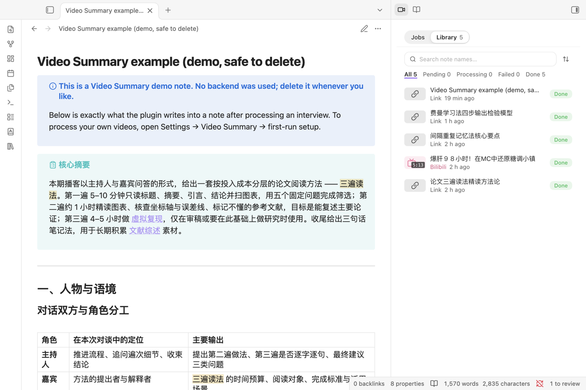
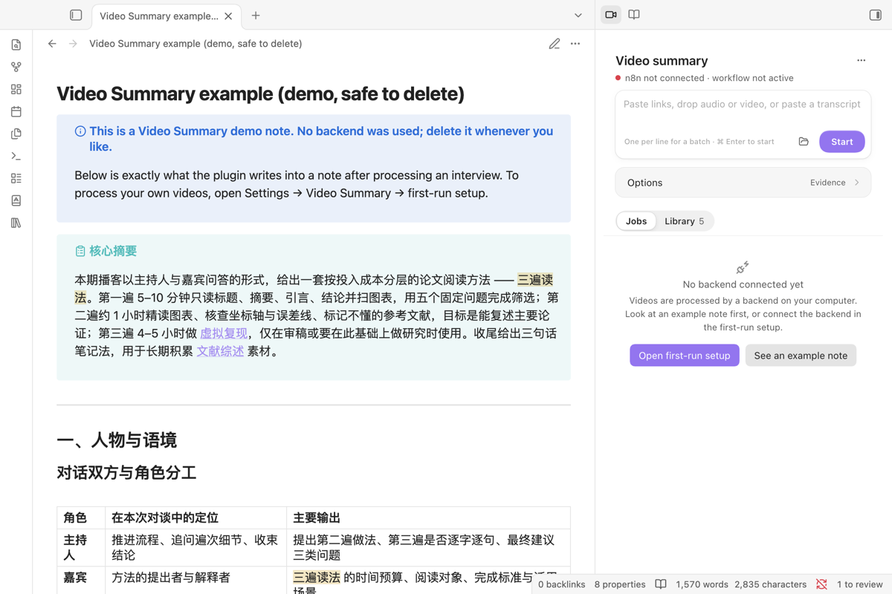
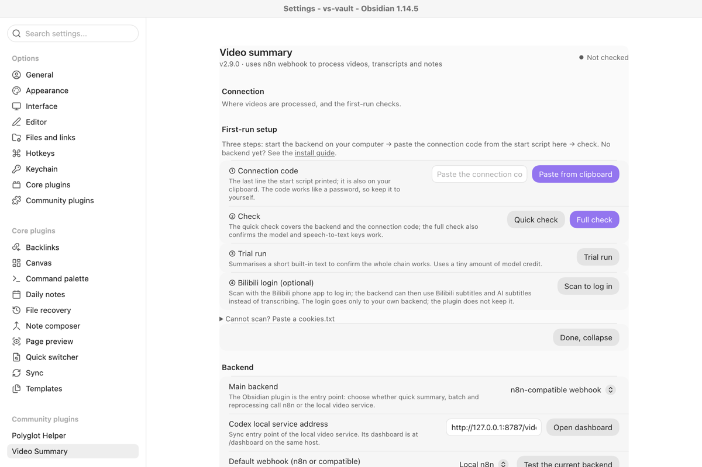
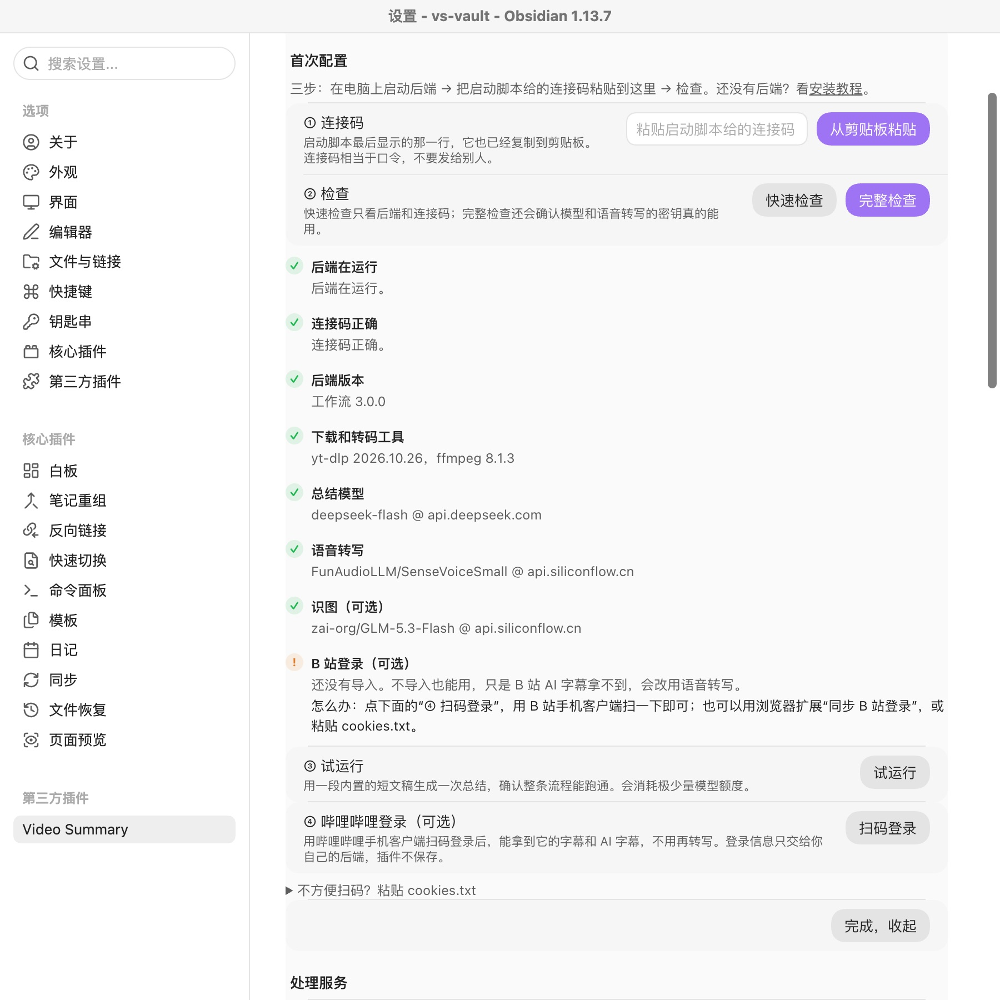
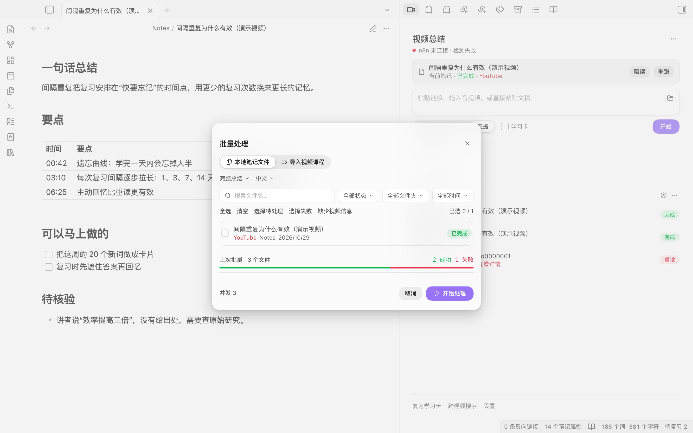

<div align="center">

# Video Summary

**Paste a video link, drop a local recording or paste a transcript, and get an Obsidian note with a summary, a timestamped transcript and key points.**

English · [中文](README.zh-CN.md) · [日本語](README.ja.md)



</div>

## Start here

1. Install and enable Video Summary, then run **Open the Video Summary side panel** from the command palette.
2. Press **See an example note**. It writes one finished note (an interview on reading papers in three passes), marked as a demo, so you can see the result before setting anything up.
3. To process your own videos, start the backend on your computer: download `video-summary-backend-<version>.zip` from the [latest release](https://github.com/Rexxall/obsidian-video-summary/releases/latest), unzip it outside your vault and double-click `start-mac.command` (macOS) or `start-windows.cmd` (Windows). It asks for your keys and prints a connection code. About 10 minutes the first time, most of it downloading the 550 MB backend image; [step-by-step guide](INSTALL.md) ([English](docs/INSTALL.en.md), [日本語](docs/INSTALL.ja.md)).
4. In **Settings → Video Summary → First-run setup**, paste the connection code, run **Full check**, then **Trial run**.
5. Paste a link into the side panel and press **Start**.

## What you need and what it costs

| Part            | What it is                                                                                         | Cost                                                                                                                                                                |
| --------------- | -------------------------------------------------------------------------------------------------- | ------------------------------------------------------------------------------------------------------------------------------------------------------------------- |
| The plugin      | Obsidian desktop                                                                                   | Free, no account                                                                                                                                                    |
| Backend hosting | n8n with yt-dlp and ffmpeg in Docker on your own computer, started by the script                   | Free: Docker Desktop or OrbStack, free for personal use; no server to rent                                                                                          |
| Speech-to-text  | SiliconFlow `SenseVoiceSmall`, used only for videos without subtitles and for local audio or video | The model is free, but SiliconFlow refuses even free models while the account balance is zero; top up a small amount once                                           |
| Summary model   | DeepSeek `deepseek-flash` by default, or any OpenAI-compatible model                               | Billed per token by the provider. In our test on 2026-10-29, eight summaries including a 47-minute video cost about ¥0.4 off-peak. Check the provider's price page. |

Bilibili login is optional and free: scan a QR code in the setup wizard to let the backend read Bilibili subtitles and AI subtitles.

## What it does

- **Input:** one link, several links (one per line), a file in the backend's `uploads/` folder, a pasted transcript, or a note with a `link` property. The `obsidian://video-summary` URI and the [browser extension](#browser-extension) capture a link from outside Obsidian.
- **Transcript:** a pasted transcript first, then the video's own subtitles (Bilibili: uploader subtitles, then Bilibili AI subtitles; danmaku are never used), then speech-to-text. YouTube and Bilibili work best; Douyin, TikTok and Xiaohongshu usually need cookies. Details: [platform matrix](docs/PLATFORM_CAPABILITY_MATRIX.md).
- **Note:** summary, key points and a timestamped transcript, shaped for the kind of video (course, interview, tutorial, news, meeting, review). Reprocessing replaces only the plugin's own blocks; if you edit the note while it runs, the plugin stops instead of overwriting.
- **Evidence mode:** timed segments, claims with their source and confidence, and a watch, skim or skip verdict with the best ranges.
- **Reader:** the video beside its transcript, click a line to seek, keep highlights. Local media and YouTube follow playback; Bilibili seeks on click.
- **Learning:** optional flashcards and questions with a local review schedule.
- **Across videos:** one search over transcripts and evidence, a claim matrix for two or more videos, and playlists compiled into a course without calling the model.
- **Side panel:** the open note, the input, jobs with their stage, elapsed time, cancel and retry, and a library of every video note. Turn on preview to confirm each result before it touches a note.

The note reads only what is said, not the picture. What the backend does, what the n8n workflow looks like and where to find errors: [backend capability matrix](docs/BACKEND_CAPABILITY_MATRIX.md).

## Screens

<table>
<tr>
<td width="50%"><br>Before setup, the side panel offers the first-run setup or an example note.</td>
<td width="50%"><br>First-run setup: paste the connection code, check, trial run, optional Bilibili login.</td>
</tr>
<tr>
<td width="50%"><br>The full check names each failing part and what to change.</td>
<td width="50%"><br>Several links at once, one per line, each with its own progress.</td>
</tr>
</table>

## Install

Download `video-summary-<version>.zip` from the [latest release](https://github.com/Rexxall/obsidian-video-summary/releases/latest) and extract `main.js`, `manifest.json` and `styles.css` into `<your-vault>/.obsidian/plugins/video-summary/`. Restart Obsidian and enable **Video Summary** in **Settings → Community plugins**. To verify the download:

```bash
grep 'video-summary-<version>.zip' SHA256SUMS | shasum -a 256 -c -
```

Desktop only; Obsidian 1.8.7 or newer. The generated `.base` library views need Obsidian 1.9.10 with the Bases core plugin.

The backend comes from the same release (`video-summary-backend-<version>.zip`). It needs Docker Desktop or OrbStack; on Linux run `./vs-backend.sh`. It listens only on `127.0.0.1` and checks the connection code's token on every request. Full guide: [INSTALL.md](INSTALL.md), with [English](docs/INSTALL.en.md) and [Japanese](docs/INSTALL.ja.md) versions; security notes: [backend/SECURITY.md](backend/SECURITY.md).

To build from source, see [CONTRIBUTING.md](CONTRIBUTING.md).

## Commands and settings

Run these from the command palette:

- `快速总结当前笔记` (quick summary of the current note)
- `将当前笔记全文作为文稿总结` (summarise the note's text as a transcript)
- `快速提取文稿` (transcript only)
- `收集当前笔记里的视频链接到侧栏` (collect the note's video links into the side panel)
- `更新视频信息（不改正文）` (refresh video details without touching the body)
- `批量处理视频` (batch)
- `搜索跨模态视频记忆`, `生成多视频论点实验室`, `复习当前视频的学习卡`, `复习所有到期的视频学习卡`
- `用本地可复现工件重新处理`, `生成或安全更新视频库 Base`, `标记为非视频笔记`

Command IDs changed in 2.6.0; hotkeys set on a manually installed 2.4.1 need setting again.

Settings cover the backend and webhook profiles (each with its own Header Auth secret, which the bundled workflow requires), output folder and file names, language, depth, content type, cache, batch concurrency, cookies, and request field names for custom n8n workflows. The cache reuses a result only when the source and every processing option match.

## Privacy and data

| What                                                                | Goes to                                                 | Stored                                                                                                                                                             |
| ------------------------------------------------------------------- | ------------------------------------------------------- | ------------------------------------------------------------------------------------------------------------------------------------------------------------------ |
| Link, pasted transcript or local file, note name, mode and language | Your backend on `127.0.0.1` only                        | The note in your vault, plus evidence and learning data in the plugin folder                                                                                       |
| Video subtitles or audio                                            | Fetched by your backend from the video platform         | The backend's working volume; downloads older than a day are removed                                                                                               |
| Audio without subtitles                                             | Your backend sends it to SiliconFlow for speech-to-text | Not kept by the plugin                                                                                                                                             |
| Transcript text                                                     | Your backend sends it to your summary model             | Not kept by the plugin                                                                                                                                             |
| Model and speech-to-text keys                                       | Only to their providers                                 | The backend's `.env` and n8n's credential store, never in the vault                                                                                                |
| Connection code (backend address and password)                      | Only to your backend                                    | The plugin's `data.json` in the vault, so it syncs with the vault. The backend listens on `127.0.0.1`, so another computer needs its own backend and its own code. |
| Bilibili login                                                      | Only to your backend                                    | The backend; the plugin does not keep it                                                                                                                           |

The plugin does not include client-side telemetry, analytics, advertising or a self-update mechanism, and sends nothing to the plugin author.

**Network use.** Besides your backend, the plugin contacts video platforms directly for playlist import, video details, short-link expansion, covers and the embedded YouTube or Bilibili player; those hosts see your IP address. Covers load only over HTTPS from known platform media hosts. Markdown written by the model has its images, embeds and active HTML neutralised before it is shown or saved.

**Node and Electron access** (desktop only). `fs` and `path` list the files in the cookies folder and read their size and age, never their contents. `http` and `https` send one request to a short link and read only its `Location` header. Electron's `shell.openPath` shows a folder in Finder or Explorer. The plugin never starts processes or runs shell commands.

**Files outside the vault.** A local-media input is sent to the backend as a file name; the bundled backend reads only files placed directly in its `uploads/` folder, and the Reader plays only files inside the vault. Evidence, learning progress, reproducibility records and course manifests are kept under the plugin's `data/` folder; back it up if you want them to survive a reinstall, and remove it before sharing a vault. The webhook secret is stored unencrypted in the plugin's `data.json`; rotate it if that file is exposed.

## Browser extension

`browser-extension/` contains **Video Summary Capture**, a Chromium extension that sends the video you are watching, with its timestamp, to Obsidian or to the same backend. It can also scan a page for video links, keep a queue and copy timestamped Markdown links. See [browser-extension/README.md](browser-extension/README.md).

## Support and license

Issues: [github.com/Rexxall/obsidian-video-summary/issues](https://github.com/Rexxall/obsidian-video-summary/issues). Changes in each version: [CHANGELOG.md](CHANGELOG.md). MIT licence, see [LICENSE](LICENSE).
