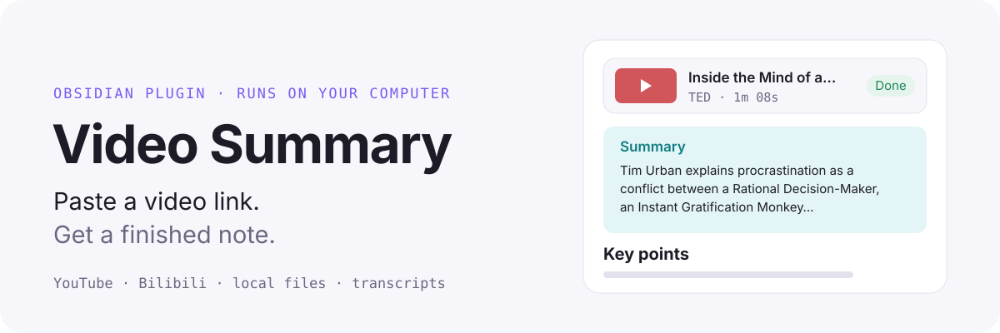
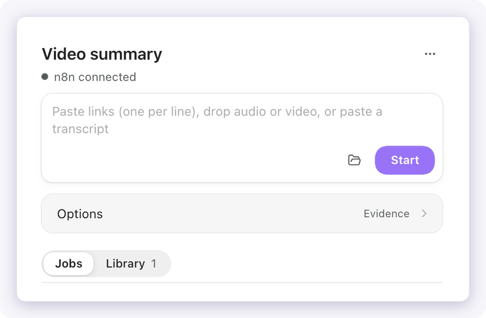
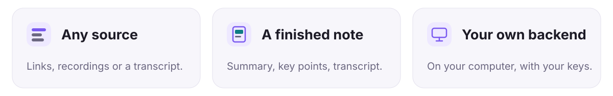
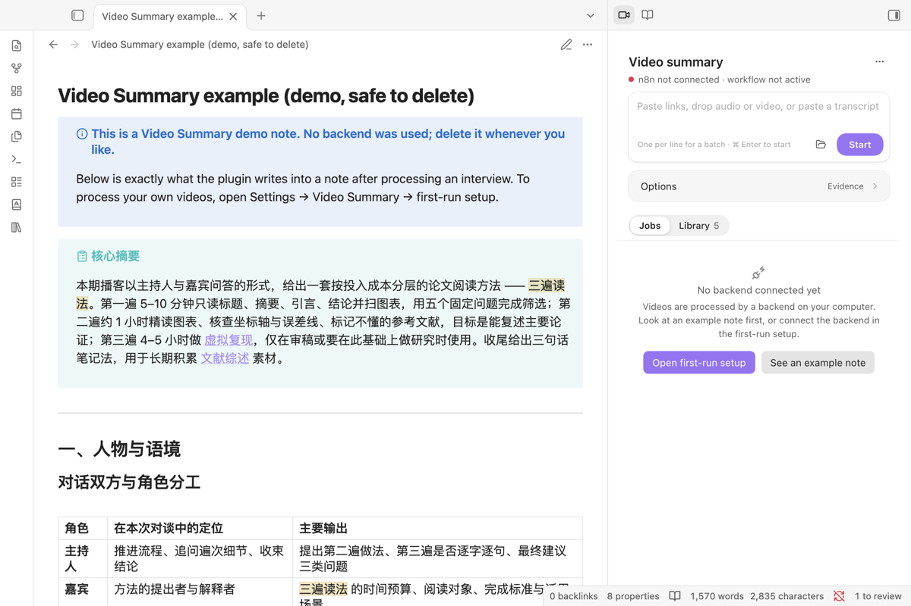
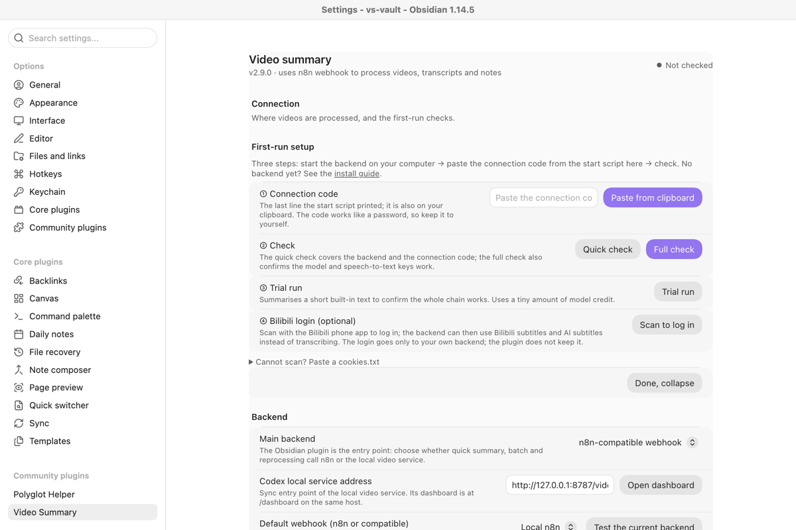
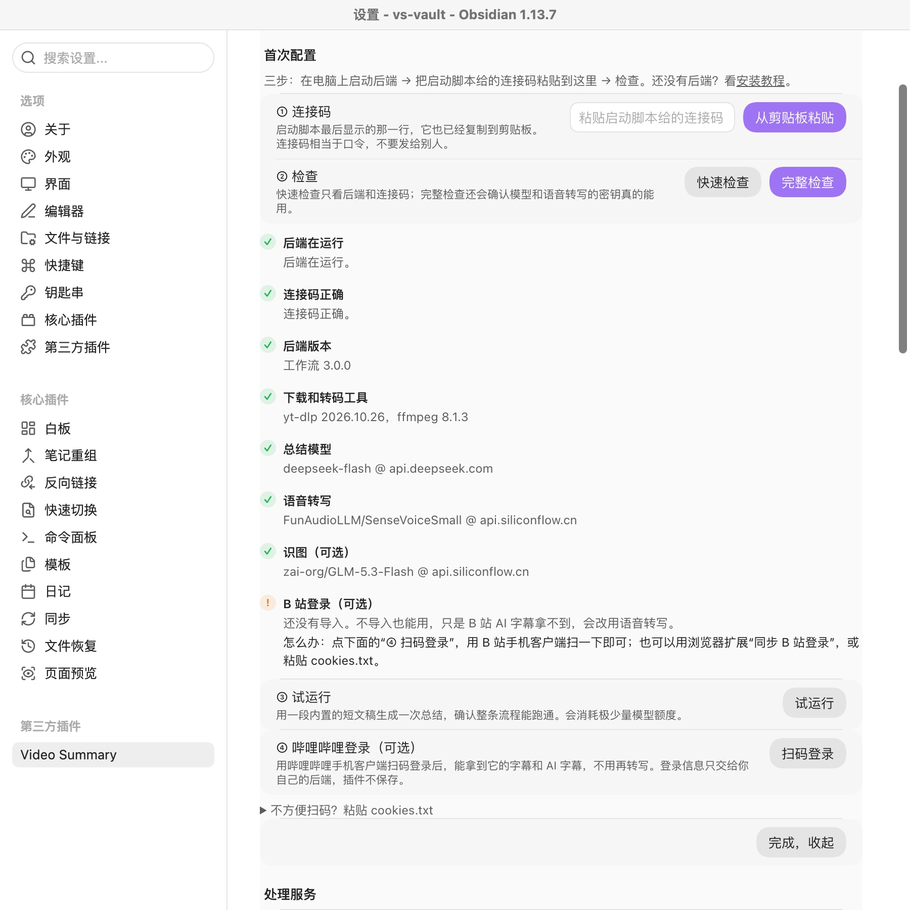
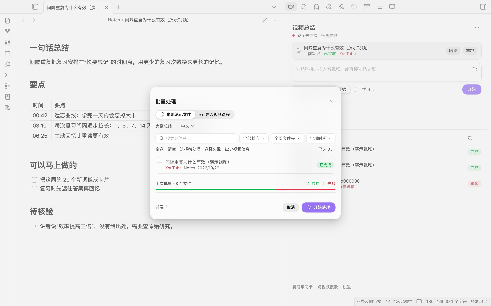

<p align="right"><a href="README.zh-CN.md">中文</a> · <a href="README.ja.md">日本語</a></p>

<picture>
  <source media="(prefers-color-scheme: dark)" srcset="assets/readme/hero-dark.svg">
  
</picture>

<p align="center"><a href="https://community.obsidian.md/plugins/video-summary"><b>Install from Obsidian</b></a></p>

<picture>
  <source media="(prefers-color-scheme: dark)" srcset="assets/readme/demo-dark.gif">
  
</picture>

<picture>
  <source media="(prefers-color-scheme: dark)" srcset="assets/readme/cards-dark.svg">
  
</picture>

## Start in three steps

1. Install **Video Summary** from _Settings → Community plugins → Browse_ and enable it. **See an example note** in the side panel shows a finished note before you set anything up.
2. Set up the backend in _Settings → Video Summary → Backend_ (macOS): choose a model, add your keys, press **Install and start**, and press Return once in the Terminal window that opens to download the backend. The check and a trial run follow by themselves. On Windows, use the [start script](INSTALL.md).
3. Paste a link into the side panel and press **Start**.

**Needs** Obsidian 1.11.4+ on desktop and Docker Desktop or OrbStack. **Costs** nothing for the plugin and the backend; the summary model is billed by your provider (eight summaries, one of them 47 minutes, cost about ¥0.4 with DeepSeek off-peak on 2026-10-29). Step-by-step guide: [INSTALL.md](INSTALL.md) ([English](docs/INSTALL.en.md), [日本語](docs/INSTALL.ja.md)).

## Everything else

<details>
<summary><b>First run, step by step</b></summary>

1. Install and enable Video Summary, then run **Open the Video Summary side panel** from the command palette.
2. Press **See an example note**. It writes one finished note (an interview on reading papers in three passes), marked as a demo, so you can see the result before setting anything up.
3. To process your own videos, install Docker Desktop or OrbStack and open **Settings → Video Summary → Backend**. On macOS: choose the summary model, add the summary key and the speech-to-text key (kept in Obsidian's secret storage), and press **Install and start**. The plugin writes the backend folder (`~/video-summary-backend`) and opens Terminal, which shows the command it will run and waits for you to press Return before downloading the 550 MB backend image. The plugin never downloads or updates anything by itself.
4. Back in Obsidian the page carries on alone: it hands the model and keys to the backend, runs the full check and a trial run. On Windows (not tested with this flow) use the start script and the connection code instead; see the [step-by-step guide](INSTALL.md) ([English](docs/INSTALL.en.md), [日本語](docs/INSTALL.ja.md)).
5. Paste a link into the side panel and press **Start**.

</details>

<details>
<summary><b>Every feature</b></summary>

- **Input:** one link, several links (one per line), a file in the backend's `uploads/` folder, a pasted transcript, or a note with a `link` property. The `obsidian://video-summary` URI and the [browser extension](browser-extension/README.md) capture a link from outside Obsidian.
- **Transcript:** a pasted transcript first, then the video's own subtitles (Bilibili: uploader subtitles, then Bilibili AI subtitles; danmaku are never used; TikTok: its captions), then speech-to-text. YouTube and Bilibili work best; Douyin, TikTok and Xiaohongshu often need cookies. Details: [platform matrix](docs/PLATFORM_CAPABILITY_MATRIX.md).
- **Note:** summary, key points and a timestamped transcript, shaped for the kind of video (course, interview, tutorial, news, meeting, review). Reprocessing replaces only the plugin's own blocks; if you edit the note while it runs, the plugin stops instead of overwriting.
- **Evidence mode:** timed segments, claims with their source and confidence, and a watch, skim or skip verdict with the best ranges.
- **Reader:** the video beside its transcript, click a line to seek, keep highlights. Local media and YouTube follow playback; Bilibili seeks on click.
- **Learning:** optional flashcards and questions with a local review schedule.
- **Across videos:** one search over transcripts and evidence, a claim matrix for two or more videos, and playlists compiled into a course without calling the model.
- **Side panel:** the open note, the input, jobs with their stage, elapsed time, cancel and retry, and a library of every video note. Turn on preview to confirm each result before it touches a note.

The note reads only what is said, not the picture. What the backend does, what the n8n workflow looks like and where to find errors: [backend capability matrix](docs/BACKEND_CAPABILITY_MATRIX.md).

<table>
<tr>
<td width="50%"><br>Before setup, the side panel offers the first-run setup or an example note.</td>
<td width="50%"><br>First-run setup: paste the connection code, check, trial run, optional Bilibili login.</td>
</tr>
<tr>
<td width="50%"><br>The full check names each failing part and what to change.</td>
<td width="50%"><br>Several links at once, one per line, each with its own progress.</td>
</tr>
</table>

</details>

<details>
<summary><b>What you need and what it costs</b></summary>

| Part            | What it is                                                                                         | Cost                                                                                                                                                                |
| --------------- | -------------------------------------------------------------------------------------------------- | ------------------------------------------------------------------------------------------------------------------------------------------------------------------- |
| The plugin      | Obsidian desktop                                                                                   | Free, no account                                                                                                                                                    |
| Backend hosting | n8n with yt-dlp and ffmpeg in Docker on your own computer, started by the script                   | Free: Docker Desktop or OrbStack, free for personal use; no server to rent                                                                                          |
| Speech-to-text  | SiliconFlow `SenseVoiceSmall`, used only for videos without subtitles and for local audio or video | The model is free, but SiliconFlow refuses even free models while the account balance is zero; top up a small amount once                                           |
| Summary model   | DeepSeek `deepseek-flash` by default, or any OpenAI-compatible model                               | Billed per token by the provider. In our test on 2026-10-29, eight summaries including a 47-minute video cost about ¥0.4 off-peak. Check the provider's price page. |

Bilibili login is optional and free: scan a QR code in the setup wizard to let the backend read Bilibili subtitles and AI subtitles.

</details>

<details>
<summary><b>Commands and settings</b></summary>

Run these from the command palette:

- `快速总结当前笔记` (quick summary of the current note)
- `将当前笔记全文作为文稿总结` (summarise the note's text as a transcript)
- `快速提取文稿` (transcript only)
- `收集当前笔记里的视频链接到侧栏` (collect the note's video links into the side panel)
- `更新视频信息（不改正文）` (refresh video details without touching the body)
- `批量处理视频` (batch)
- `搜索跨模态视频记忆`, `生成多视频论点实验室`, `复习当前视频的学习卡`, `复习所有到期的视频学习卡`
- `用本地可复现工件重新处理`, `生成或安全更新视频库 Base`, `标记为非视频笔记`

Command IDs changed in 2.6.0; hotkeys set on a manually installed 2.4.1 need setting again.

Settings cover the backend and webhook profiles (each with its own Header Auth secret, which the bundled workflow requires), output folder and file names, language, depth, content type, cache, batch concurrency, cookies, and request field names for custom n8n workflows. The cache reuses a result only when the source and every processing option match.

</details>

<details>
<summary><b>Safety, privacy and what the plugin touches</b></summary>

| What                                                                | Goes to                                                  | Stored                                                                                                                                                                                                                                                                                                   |
| ------------------------------------------------------------------- | -------------------------------------------------------- | -------------------------------------------------------------------------------------------------------------------------------------------------------------------------------------------------------------------------------------------------------------------------------------------------------- |
| Link, pasted transcript or local file, note name, mode and language | Your backend on `127.0.0.1` only (light tier: see below) | The note in your vault, plus evidence and learning data in the plugin folder                                                                                                                                                                                                                             |
| Video subtitles or audio                                            | Fetched by your backend from the video platform          | The backend's working volume; downloads older than a day are removed                                                                                                                                                                                                                                     |
| Audio without subtitles                                             | Your backend sends it to SiliconFlow for speech-to-text  | Not kept by the plugin                                                                                                                                                                                                                                                                                   |
| Transcript text                                                     | Your backend sends it to your summary model              | Not kept by the plugin                                                                                                                                                                                                                                                                                   |
| Model and speech-to-text keys                                       | Only to their providers, through your backend            | Keys chosen in settings: Obsidian's secret storage, and the backend's own Docker volume (n8n's encrypted credential store plus one file only the container user can read). Keys from the start script: the backend's `.env`. Never in the vault, `data.json`, a command line or an n8n execution record. |
| Connection code (backend address and password)                      | Only to your backend                                     | The plugin's `data.json` in the vault, so it syncs with the vault. The backend listens on `127.0.0.1`, so another computer needs its own backend and its own code.                                                                                                                                       |
| Bilibili login                                                      | Only to your backend                                     | The backend; the plugin does not keep it                                                                                                                                                                                                                                                                 |
| Light tier: transcript text, title and your summary key             | The plugin sends them to your summary model directly     | Not kept by the plugin beyond the note it writes                                                                                                                                                                                                                                                         |

The plugin does not include client-side telemetry, analytics, advertising or a self-update mechanism, and sends nothing to the plugin author.

### What the plugin touches

**Notes in your vault.** The plugin lists the vault's Markdown files to find video notes: for the side panel's library, for the pending-video batch, to open the note behind a job, and to find the existing note before a result, capture or course import would create a duplicate. It reads frontmatter from Obsidian's metadata cache; when a note's frontmatter lacks the field it looks for (a video link, a source hash, an artifact ID), it reads the note text for that field. What it reads stays on your computer. It lists folders only when you pick an output folder, and changes a note only when you process it, then only its own blocks.

**Clipboard.** It writes to the clipboard only when you press a copy action: a note's video link, a transcript quote, a job's error or raw result. It reads the clipboard only when you press **Paste from clipboard** in first-run setup, to take the connection code.

**Local cache.** Processing results, evidence, learning progress and Bilibili cover addresses are kept as files under the plugin's `data/` folder (results and covers in `data/cache/`), not in `data.json` and not in the browser's local storage. **Clear all** in the cache settings removes cached results.

**Network use.** Besides your backend, the plugin contacts your summary model's address for light-tier jobs (only when a job carries a transcript and the light tier is on), and video platforms directly for playlist import (`youtube.com`, `api.bilibili.com`), Bilibili covers (`api.bilibili.com`), short-link expansion, the QR login in first-run setup (`passport.bilibili.com`; the resulting login goes only to your backend) and the embedded YouTube or Bilibili player; those hosts see your IP address. Covers load only over HTTPS from known platform media hosts. Markdown written by the model has its images, embeds and active HTML neutralised before it is shown or saved.

**Node and Electron access** (desktop only). `fs` and `path` list the files in the cookies folder and read their size and age, never their contents. `http` and `https` send one request to a short link and read only its `Location` header, and stream the summary model's reply for light-tier jobs. Electron's `shell.openPath` shows a folder in Finder or Explorer.

**Programs the plugin runs** (desktop only, and only for a backend on this computer). The backend check-up and the Backend settings run `docker info`, `docker ps` and `docker inspect` to show whether Docker and the backend container are running. **Start backend** opens OrbStack or Docker Desktop, then runs `docker start` on the container that owns the webhook's port, or `docker compose up -d --no-build --pull never` in the backend folder when no container exists yet. **Stop** runs `docker stop`; the start-with-the-computer switch runs `docker update --restart`. When you change the model or a key in settings, the plugin runs `docker exec -i … configure.mjs apply` with the values on standard input, then `docker restart`. **Install and start** and **Update backend** open Terminal on a script the plugin wrote; the script prints `docker compose pull && docker compose up -d` and runs it only after you press Return. Each program is run directly with a fixed argument list and no shell. The plugin never downloads, builds or updates the backend by itself: downloading and updating happen in that Terminal window, on your confirmation.

**Files outside the vault.** **Install and start** writes the backend folder (by default `~/video-summary-backend`): `compose.yaml`, `.env` with a random token and the port, `install-backend.command`, and empty `uploads` and `cookies` folders; an existing `.env` keeps every line it has. A local-media input is sent to the backend as a file name; the bundled backend reads only files placed directly in its `uploads/` folder, and the Reader plays only files inside the vault. Evidence, learning progress, reproducibility records and course manifests are kept under the plugin's `data/` folder; back it up if you want them to survive a reinstall, and remove it before sharing a vault. The webhook secret is stored unencrypted in the plugin's `data.json`; rotate it if that file is exposed.

</details>

<details>
<summary><b>Install by hand and verify a release</b></summary>

Download `main.js`, `manifest.json` and `styles.css` from the [latest release](https://github.com/Rexxall/obsidian-video-summary/releases/latest) into `<your-vault>/.obsidian/plugins/video-summary/`. Restart Obsidian and enable **Video Summary** in **Settings → Community plugins**. To verify a download:

```bash
gh attestation verify main.js --repo Rexxall/obsidian-video-summary
```

Desktop only; Obsidian 1.11.4 or newer. The generated `.base` library views need Obsidian 1.9.10 with the Bases core plugin.

The backend has its own release, `backend-v<version>`, linked from the plugin release under **Other downloads** (`video-summary-backend-<version>.zip`, with a `SHA256SUMS`). It needs Docker Desktop or OrbStack; on Linux run `./vs-backend.sh`. It listens only on `127.0.0.1` and checks the connection code's token on every request. Full guide: [INSTALL.md](INSTALL.md), with [English](docs/INSTALL.en.md) and [Japanese](docs/INSTALL.ja.md) versions; security notes: [backend/SECURITY.md](backend/SECURITY.md).

To build from source, see [CONTRIBUTING.md](CONTRIBUTING.md).

</details>

<details>
<summary><b>Browser extension</b></summary>

`browser-extension/` contains **Video Summary Capture**, a Chromium extension that sends the video you are watching, with its timestamp, to Obsidian or to the same backend. It can also scan a page for video links, keep a queue and copy timestamped Markdown links. See [browser-extension/README.md](browser-extension/README.md).

</details>

Issues: [github.com/Rexxall/obsidian-video-summary/issues](https://github.com/Rexxall/obsidian-video-summary/issues). Changes in each version: [CHANGELOG.md](CHANGELOG.md). MIT licence, see [LICENSE](LICENSE).
