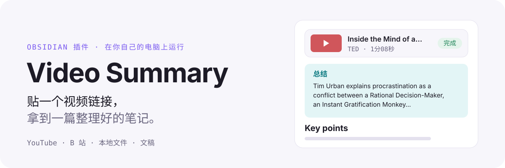
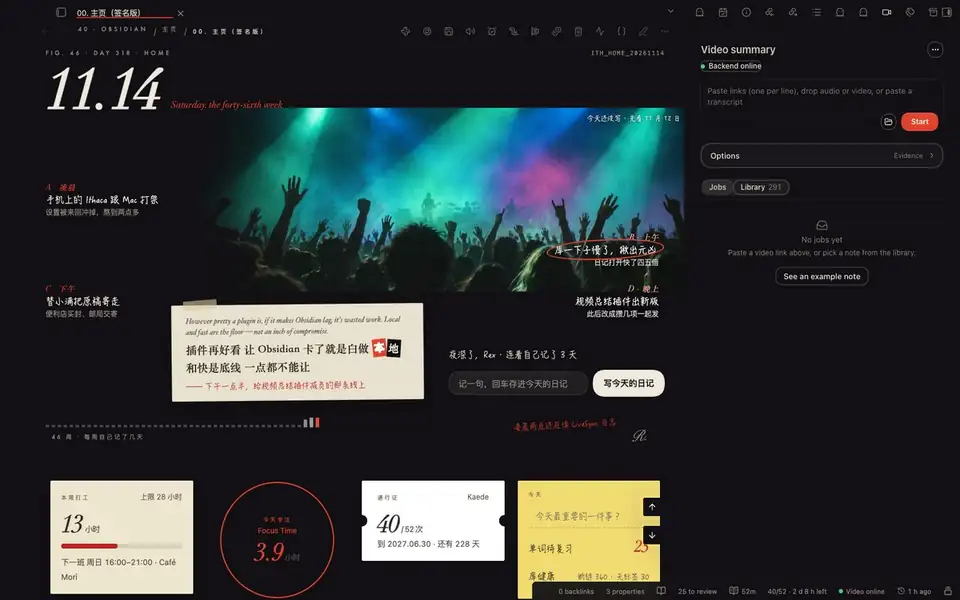
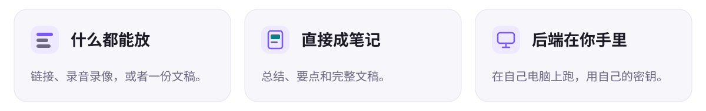
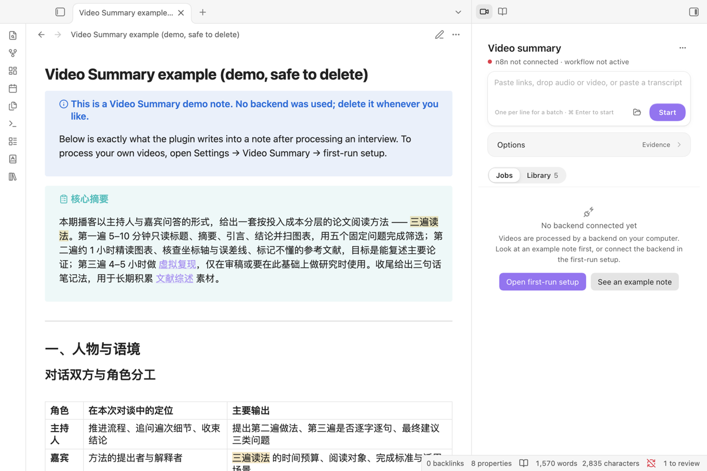
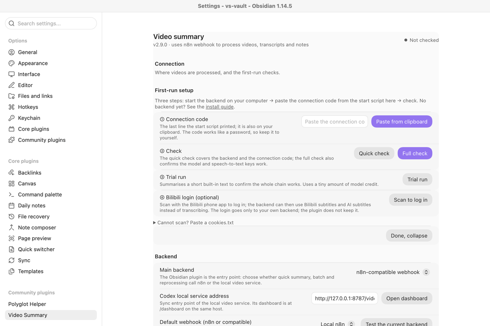
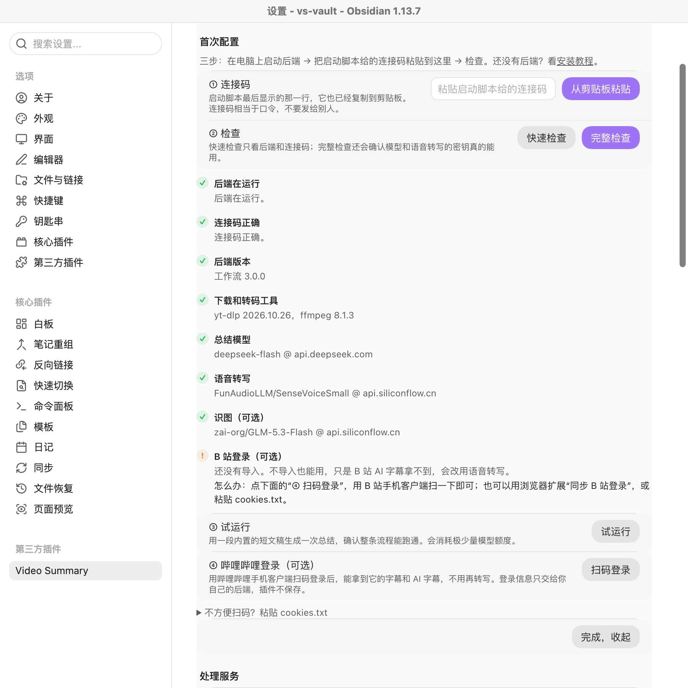
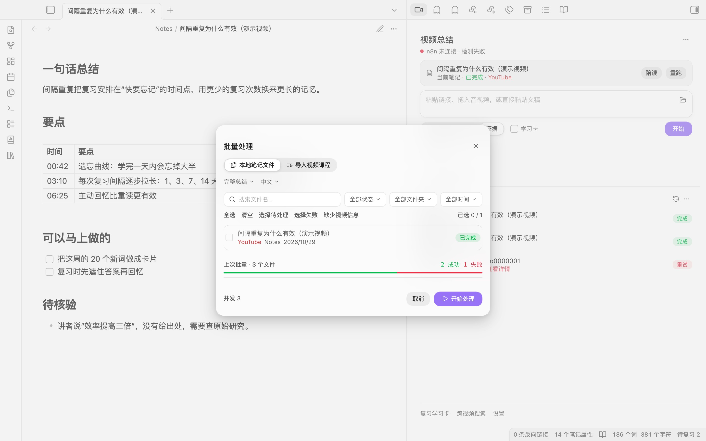

<a href="README.md">English</a> · <a href="README.ja.md">日本語</a>

<picture><source media="(prefers-color-scheme: dark)" srcset="assets/readme/icon-dark.svg"></picture>

<picture>
  <source media="(prefers-color-scheme: dark)" srcset="assets/readme/hero-zh-dark.svg">
  
</picture>

<a href="https://community.obsidian.md/plugins/video-summary"><b>在 Obsidian 里安装</b></a>

<picture>
  <source media="(prefers-color-scheme: dark)" srcset="assets/readme/cards-zh-dark.svg">
  
</picture>

## 三步上手

1. 在“设置 → 第三方插件 → 浏览”里搜索 **Video Summary**，安装并启用。侧栏里点 **看示例笔记**，不用配置就能先看到成品。
2. 装后端（macOS）：在“设置 → Video Summary → 后端”里选模型、填密钥，点“安装并启动”，在弹出的终端窗口里按一次回车下载后端。之后的检查和试跑自动完成。Windows 用[启动脚本](INSTALL.md)。
3. 在侧栏贴一个链接，点 **开始**。

**需要** 桌面版 Obsidian 1.11.4 或更新，和 Docker Desktop 或 OrbStack。**费用** 插件和后端不要钱；总结模型由服务商按用量收费（2026-10-29 实测：8 次总结，其中一段 47 分钟，DeepSeek 非高峰时段共约 0.4 元）。详细步骤见 [安装教程](INSTALL.md)。

截图和动图是英文界面。Obsidian 设为中文时，插件界面也是中文。

## 其余内容

<b>第一次使用的完整步骤</b>

1. 安装并启用 Video Summary，在命令面板运行“打开视频总结侧栏”。
2. 点 **看示例笔记**：插件会写一篇已经完成的笔记（一期讲“论文三遍读法”的访谈），标着“演示，可删除”，不用装任何东西就能先看到成品。
3. 想处理自己的视频，先装 Docker Desktop 或 OrbStack，再打开 **设置 → Video Summary → 后端**。macOS 上：选总结模型，填总结密钥和语音转写密钥（存在 Obsidian 的钥匙串里），点 **安装并启动**。插件写好后端文件夹（`~/video-summary-backend`）并打开终端；终端先写明要运行的命令，等你按回车才下载约 550 MB 的后端镜像。插件不会自己下载或更新任何东西。
4. 回到 Obsidian，设置页会自己把模型和密钥交给后端，做完整检查和一次试跑。Windows 还没有实测这条流程，请用启动脚本和连接码，见 [安装教程](INSTALL.md)。
5. 在侧栏贴一个链接，点 **开始**。

<b>需要什么、花多少钱</b>

| 部分       | 是什么                                                             | 费用                                                                                                             |
| ---------- | ------------------------------------------------------------------ | ---------------------------------------------------------------------------------------------------------------- |
| 插件本身   | Obsidian 桌面版插件                                                | 免费，不用注册账号                                                                                               |
| 后端运行   | 在你自己电脑的 Docker 里跑 n8n、yt-dlp 和 ffmpeg，由启动脚本装好   | 免费：Docker Desktop 或 OrbStack 个人使用免费，不用租服务器                                                      |
| 语音转文字 | 硅基流动 `SenseVoiceSmall`，只在视频没有字幕、或处理本地音视频时用 | 模型免费，但硅基流动账户余额为 0 时连免费模型也会拒绝，充值一两元即可                                            |
| 总结模型   | 默认 DeepSeek `deepseek-flash`，也可以换任何兼容 OpenAI 格式的模型 | 服务商按词元收费。2026-10-29 实测：8 次总结（含一段 47 分钟的视频）在非高峰时段共约 0.4 元。以服务商价格页为准。 |

B 站登录可选、免费：在首次配置里用哔哩哔哩手机客户端扫码，后端就能读取 B 站字幕和 AI 字幕。

<b>特点和界面</b>

- 处理服务由你自己掌控，插件本身没有账号、不收集数据。
- B 站优先用 UP 主字幕，其次 B 站 AI 字幕，最后才转写音频；不会把弹幕当文稿。
- 重新处理时只替换插件自己的区块，你写在笔记里的内容不会被覆盖；处理期间你改过笔记，插件会停下来，不会覆盖。
- 侧栏可以看任务进度、取消任务、预览后再写入，跟着时间戳阅读文稿。

完整功能、命令、设置和隐私细节见 [英文说明](README.md)，更新记录见 [CHANGELOG.md](CHANGELOG.md)。

<table>
<tr>
<td width="50%"> 还没配置时，侧栏给出“打开首次配置”和“看示例笔记”。</td>
<td width="50%"> 首次配置：粘贴连接码、检测、试运行，可选 B 站扫码登录。</td>
</tr>
<tr>
<td width="50%"> 完整检查会指出哪一项没通过、该改什么。</td>
<td width="50%"> 一次贴多个链接，一行一个，各自显示进度。</td>
</tr>
</table>

<b>数据发到哪里、存在哪里</b>

| 内容                                               | 发给谁                              | 存在哪里                                                                                                                                                                                                                                                           |
| -------------------------------------------------- | ----------------------------------- | ------------------------------------------------------------------------------------------------------------------------------------------------------------------------------------------------------------------------------------------------------------------ |
| 链接、粘贴的文稿或本地文件、笔记名、处理方式和语言 | 只发给你电脑上的后端（`127.0.0.1`） | 库里的笔记；证据和学习数据在插件文件夹                                                                                                                                                                                                                             |
| 视频字幕或音频                                     | 后端从视频平台获取                  | 后端的工作卷，超过一天的下载会自动删除                                                                                                                                                                                                                             |
| 没有字幕时的音频                                   | 后端发给硅基流动转文字              | 插件不保存                                                                                                                                                                                                                                                         |
| 文稿文字                                           | 后端发给你选的总结模型              | 插件不保存                                                                                                                                                                                                                                                         |
| 模型和语音转写的密钥                               | 经你的后端只发给对应服务商          | 设置页里选的：Obsidian 的钥匙串；插件用 `docker exec` 把它从标准输入交给本机后端，后端存进自己的数据卷（n8n 的加密凭据，另有一份只有容器用户可读的文件）。不进笔记库、`data.json`、`.env`、命令行参数和 n8n 的执行记录。用启动脚本装的后端，密钥仍在它的 `.env` 里 |
| 连接码（后端地址和密码）                           | 只发给你的后端                      | 插件在库里的 `data.json`，会随库同步。后端只监听 `127.0.0.1`，换一台电脑要在那台电脑上另装后端、用它自己的连接码。                                                                                                                                                 |
| B 站登录                                           | 只发给你的后端                      | 存在后端；插件不保存                                                                                                                                                                                                                                               |

**给浏览器扩展的本机端口。** 默认关闭，在设置里打开“后台接收，不切到 Obsidian”后，电脑版插件才在 `127.0.0.1` 上监听一个端口（默认 27183，可改），浏览器扩展把视频直接递过来，Obsidian 不会被调到前台。只接受带配对码的请求（在 **设置 → Video Summary → 浏览器扩展** 里），拒绝网页发来的请求，能做的事和 `obsidian://video-summary` 链接一样。可以在那里关掉。

插件没有遥测、没有统计，不向作者发送任何数据。

MIT 许可。
