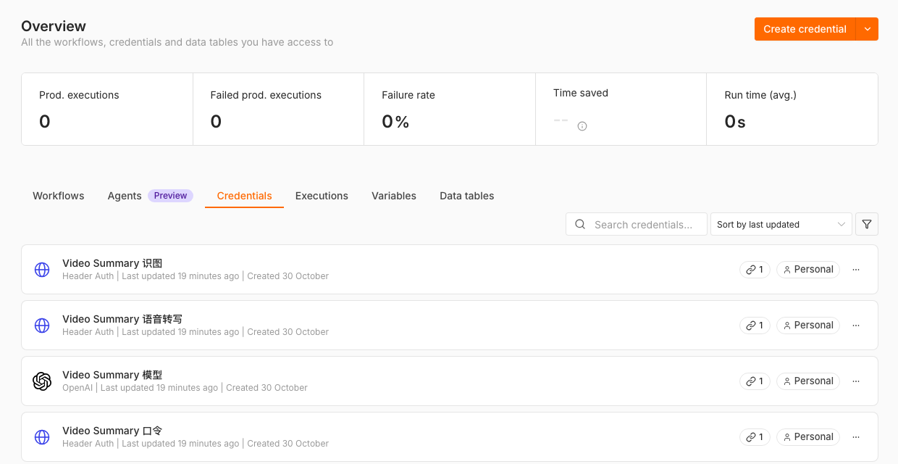
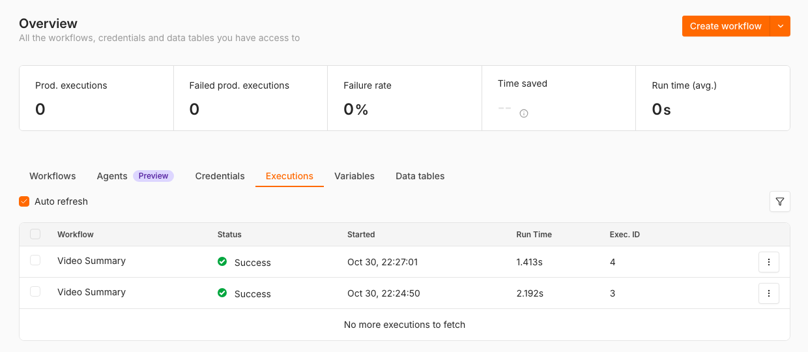

# 后端能力矩阵（Backend Capability Matrix）

Video Summary 只有一种处理后端：后端安装包里的 n8n 工作流。没有后端时，`obsidian://video-summary` 仍能把链接收进 Vault，稍后再处理。

最后核对：2026-10-30，插件 2.11.0，工作流 3.1.0。

## 能力对照

| 能力                  | 附带的 n8n 工作流                                         | Obsidian URI 收件   |
| --------------------- | --------------------------------------------------------- | ------------------- |
| URL / 文稿 / 本地文件 | 支持；本地文件只接受后端 `uploads/` 根目录里的文件名      | 先保存来源          |
| `yt-dlp` 下载与元数据 | 支持                                                      | 不处理              |
| 原生字幕              | 支持；哔哩哔哩登录后还能用 UP 主字幕和 AI 字幕            | 不处理              |
| 无字幕时音频转写      | 支持；后端自带语音转写子工作流（默认硅基流动 SenseVoice） | 不处理              |
| 语音时间轴与证据主张  | 支持 `quick` 和 `evidence` 两档                           | 不处理              |
| 画面 / 关键帧分析     | 不支持。只整理讲者口述的画面内容，并注明是讲者的描述      | 不处理              |
| 任务阶段与取消        | 单次 webhook：插件显示计时，取消只停止插件侧等待          | 不适用              |
| 后端离线时收件        | 不适用                                                    | `capture-only` 可用 |

## 工作流里有什么

在 n8n 里打开 **Video Summary** 工作流，左上角的黄色便签说明整体流程，每条灰色便签对应一种请求：健康检查、Cookies、本地文件、粘贴文稿、视频链接、视频信息，最右边是共用的“写笔记”段。

- **AI: Write Note** 是唯一的 AI 步骤，提示词也在这里。回复不是合法 JSON 时，**Code: Parse Note JSON** 让它重写，最多三次；密钥或模型名错误会直接停下并给出提示。
- 笔记按请求语言（中文、英文、日文）写，开头是摘要，接着是要点，再按内容类型（课程、访谈、教程、新闻、会议、评测、通用）分节。原文细节放在折叠块里，完整时间轴文稿由插件附在笔记后面。
- 密钥在后端 `.env` 里，启动脚本把它们写成 n8n 的凭据（Overview → Credentials），不需要在 n8n 里粘贴。

## 出错时去哪看

在 n8n 顶部点 **Executions**，打开最近一次运行。模型或密钥出错时，这次运行仍显示 Success，因为错误要原样交回插件。打开 **AI: Write Note** 才能看到原因。

## 重要边界

- Webhook 强制使用 n8n `Header Auth`，Header 名称是 `X-Video-Summary-Token`，值由启动脚本生成，写在连接码里。Docker Compose 只监听 `127.0.0.1`；要开放到局域网或公网，必须另加 TLS、访问控制和限流。
- 本地文件必须直接放在后端文件夹的 `uploads/` 根目录，请求里只发送文件名。子目录、绝对路径、斜杠和 shell 元字符都会被拒绝。`obsidian://` 链接里的绝对路径只能离线收件。
- `obsidian://video-summary` 默认执行 `capture-only`：创建或复用一条待处理笔记，不调用 AI。显式传入 `capture-and-process` 或 `process` 时才送去后端。

## 数据与凭据

模型和语音转写密钥只在后端 `.env` 和 n8n 凭据库里。Webhook Secret 保存在 Obsidian 插件的 `data.json` 中（明文，由本机文件权限保护），不要同步、分享或提交这个文件；怀疑泄露时清空后端 `.env` 里的 `VS_WEBHOOK_TOKEN` 再运行启动脚本，会生成新的口令和连接码。插件的结构化结果、学习进度与课程状态保存在插件数据目录，详见 [README 的隐私与数据](../README.md#privacy-and-data)。
