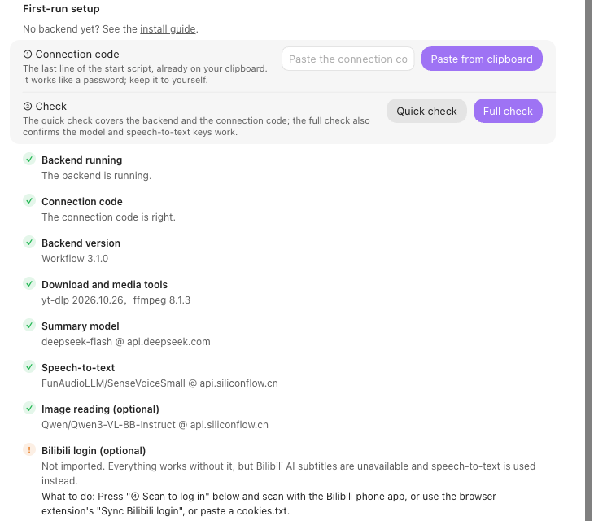
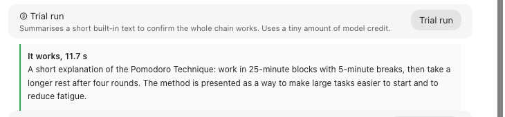
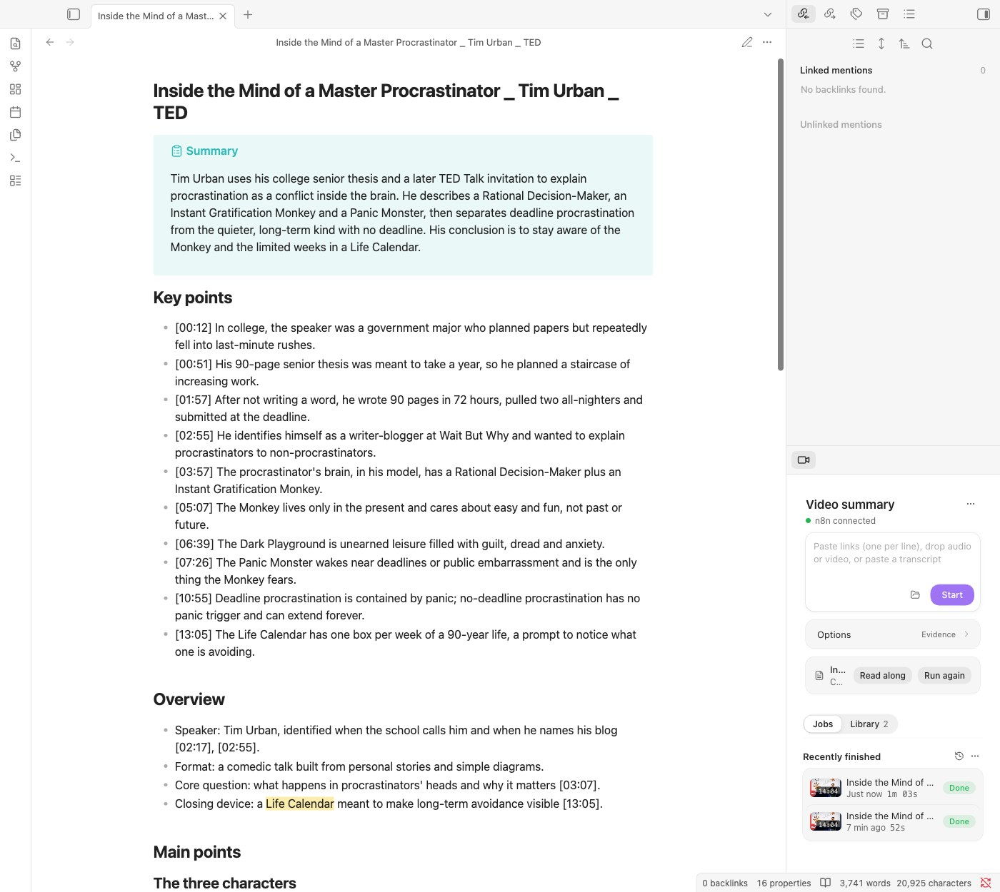

# Installation

[中文（完整版）](../INSTALL.md) · [日本語](INSTALL.ja.md)

Video Summary has two parts: the Obsidian plugin, and a backend that runs on your own computer in
Docker and fetches subtitles or audio, transcribes, and asks a model for the summary. A start script
sets the backend up; no coding is needed.

**About 10 minutes in all.** The backend is a ready-made image of about 550 MB; the first
download usually takes 1–5 minutes.

## Four steps

### 1. Plugin and Docker

- **Plugin:** in Obsidian, **Settings → Community plugins → Browse**, search for **Video Summary**,
  install and enable it. If it is not listed yet, copy `main.js`, `manifest.json` and `styles.css`
  from the [latest release](https://github.com/Rexxall/obsidian-video-summary/releases/latest) into
  `<vault>/.obsidian/plugins/video-summary/`.
- **Docker:** install [Docker Desktop](https://www.docker.com/products/docker-desktop/) (Windows,
  macOS) or [OrbStack](https://orbstack.dev) (macOS) and start it.
- **Keys:** one for an OpenAI-compatible chat model (default DeepSeek, `deepseek-flash`), and
  optionally a [SiliconFlow](https://cloud.siliconflow.cn/account/ak) key for speech-to-text of
  videos without subtitles (its SenseVoice model is free).

### 2. Download the backend and start it

Download `video-summary-backend-<version>.zip` from the
[latest release](https://github.com/Rexxall/obsidian-video-summary/releases/latest) and unzip it
somewhere permanent, outside your vault. Then on macOS right-click `start-mac.command` → Open; on
Windows double-click `start-windows.cmd`; on Linux run `./vs-backend.sh`.

The first start asks for the two keys. Nothing is shown while you paste; press Enter, or press
Enter alone to skip one for now.

The script then downloads the backend image and starts it. It ends with a **connection code** and
copies it to the clipboard. The code is the backend's password; keep it private.
`./vs-backend.sh code` shows it again.

### 3. Paste the code, check, trial run

In Obsidian, open **Settings → Video Summary → First-run setup**: paste the code, run the
**Full check**, then the **Trial run**. Each failing check says what to change. Bilibili login is
optional; after it, Bilibili videos use their own subtitles instead of speech-to-text.

### 4. Summarize a video

Paste a video link into the input in the side panel and press **Start**. The note opens with a
summary and key points, then sections and the timestamped transcript.

## Everyday commands

`./vs-backend.sh` (Windows: `.\vs-backend.ps1`) followed by nothing (start, and apply `.env`
changes), `check`, `code`, `keys`, `logs`, `stop` or `update` (download this version's image
again, or rebuild it). To upgrade, unzip a newer backend package over the old folder (`.env` stays)
and run `update`.

To use another model, edit `VS_CHAT_BASE_URL`, `VS_CHAT_MODEL` and `VS_CHAT_API_KEY` in `.env` and
run the start script again. The table in the [Chinese guide](../INSTALL.md#换模型) lists tested
settings.

## Troubleshooting

Run the full check in the plugin first; it names the setting to fix. Common cases: Docker not
running (open it, rerun the script); the image download is slow or blocked (the script builds the
image locally instead, about 10 minutes; in mainland China set `VS_MIRROR=cn` in `.env` to build
with local mirrors right away); port 5678 taken (the script picks the next free port, the code
already has it); "not ready" right after start (wait a minute); wrong key (`./vs-backend.sh keys`);
YouTube blocked on your network (set `VS_HTTP_PROXY`). The backend listens only on `127.0.0.1`; see
[backend/SECURITY.md](../backend/SECURITY.md) before exposing it anywhere else.

To see which step failed, open the address in the connection code (by default
<http://127.0.0.1:5678>) in a browser; the first visit creates an n8n account that stays on your
computer. Open **Executions**, then the latest run. A model or key problem still shows Success,
because the error is handed back to the plugin: open **AI: Write Note** and read its output.

